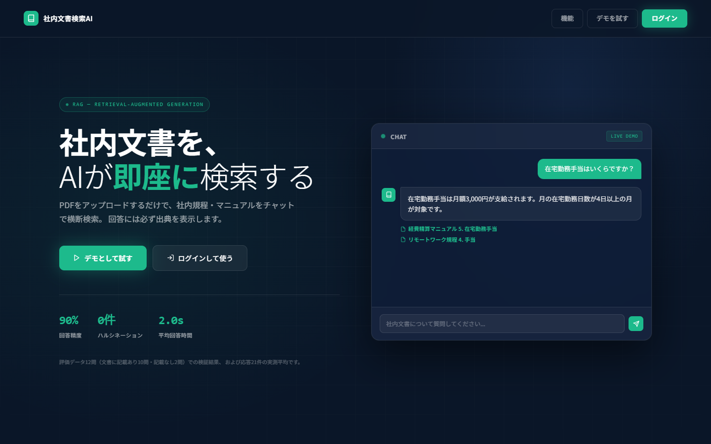
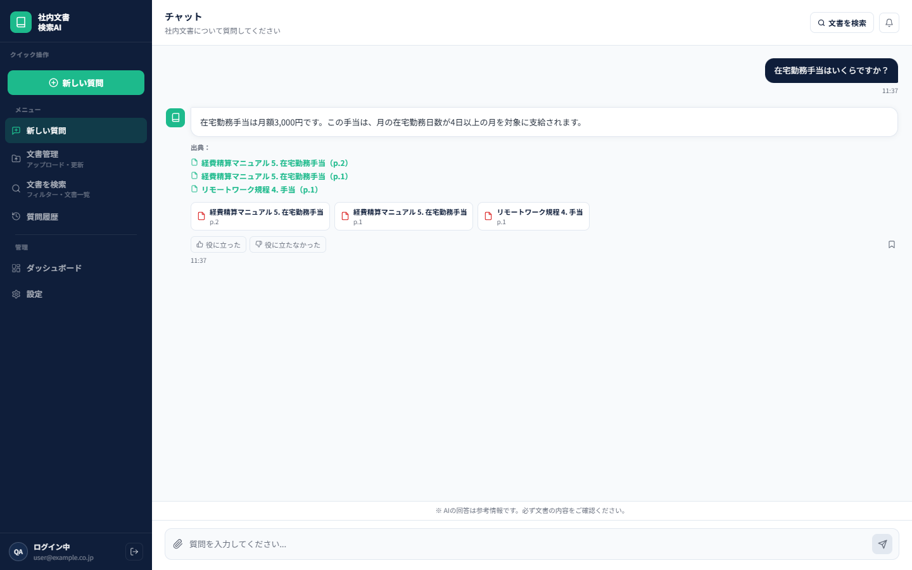
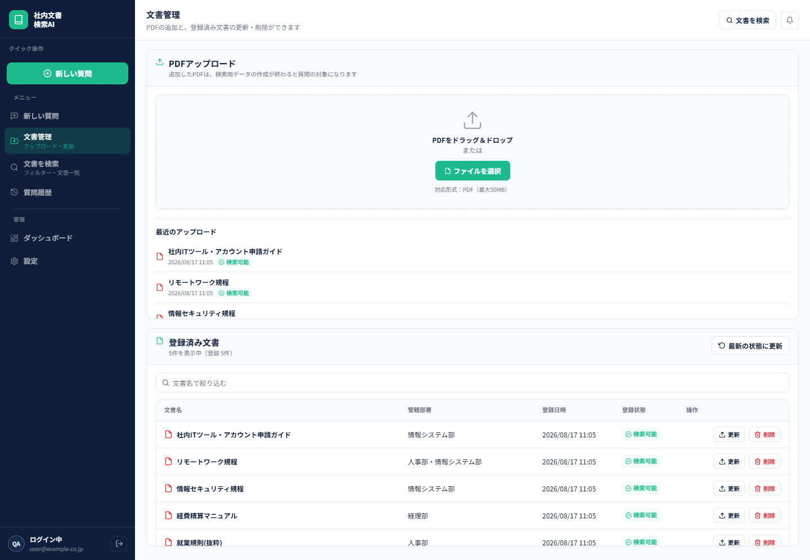
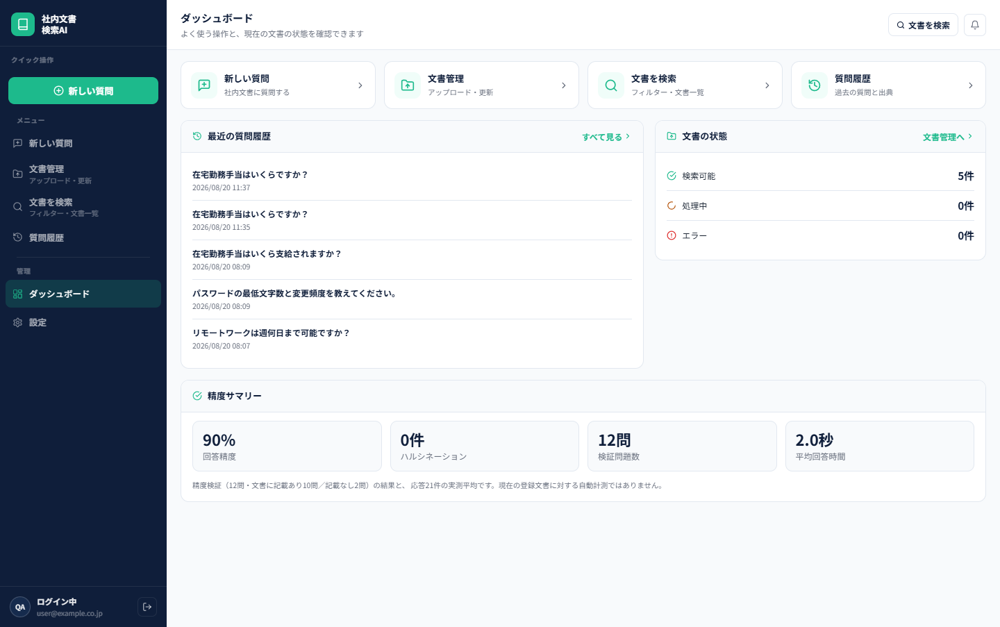
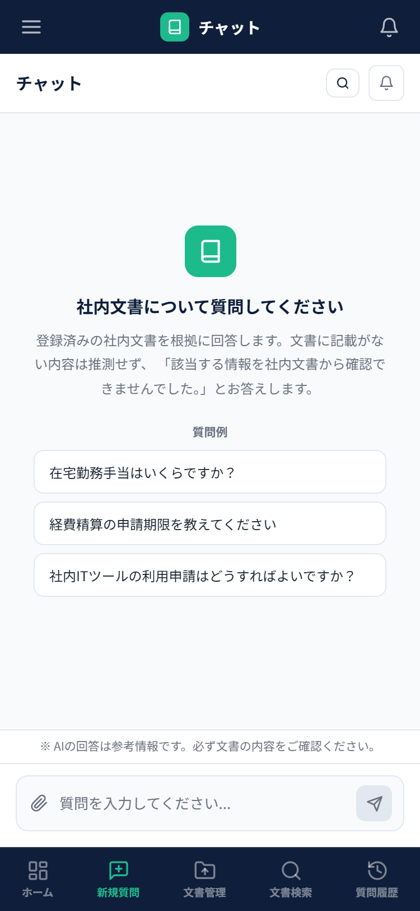
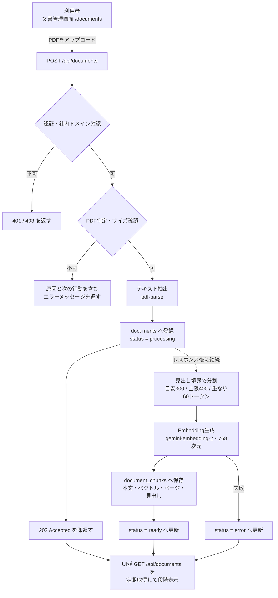
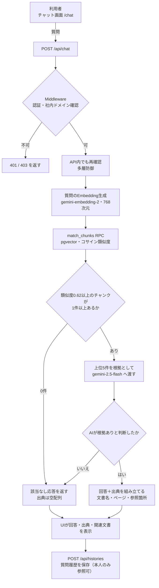

# 社内文書検索AI（RAG）


社内文書検索AI（RAG）MVP　従業員約50名の企業向け受託開発案件

---

## 3行でわかること

1. **何をするシステムか** — 社内のPDFを登録しておくと、社員がチャットで質問するだけで答えが返ります。
2. **他の検索と何が違うか** — 回答には必ず**根拠の文書名とページ**が付き、**書かれていないことは推測せず「確認できませんでした」**と答えます。
3. **どこまでできるか** — 5文書・12問の検証で、記載のある質問への正答率は**100%**、でたらめな回答は**0件**でした。

---

## 読む人別の案内

**目的に合った資料から読んでください。** このREADMEは全体の入口です。

| あなたの立場 | 最初に読む資料 | 分かること |
|---|---|---|
| **システムを使う社員** | [使い方ガイド](docs/operations.md#11-使い方ガイド社員向け) | 質問の仕方・質問のコツ |
| **文書を登録・更新する担当者** | [運用手順書](docs/operations.md) | PDFの登録・更新・削除・トラブル対応 |
| **情報システム部門・社内へ説明する方** | [システム構成の説明資料](docs/system-overview.md) | 構成図・社内説明用Q&A・確認すべきこと |
| **発注を判断する方** | [Phase 2 ご提案](docs/phase2-proposal.md) | 次に何ができるか・費用・工数 |
| **精度を確認したい方** | [検証レポート](docs/validation/rag-accuracy-report.md) | 12問の検証結果と限界 |
| **開発・保守する方** | [アーキテクチャ詳細](docs/architecture.md) ＋ 本READMEの「開発者向け」以降 | 技術構成・DB・API・セットアップ |

> **専門用語なしで読める資料**：運用手順書／システム構成の説明資料／Phase 2 ご提案／検証レポート

---

## デモURL

TODO：Vercelデプロイ後に追記

APIキーをお持ちの方は、ログイン不要のデモ（`/demo`）でも動作を確認できます。
ご自身のGemini APIキーをブラウザに入力して試す形式で、サンプル文書5件のみを対象とします。

---

# Part 1　このシステムについて

> **どなたでもお読みいただけます。** 専門知識は不要です。

## 何ができるシステムか

社内のPDF（就業規則・各種マニュアル・規程など）をあらかじめ登録しておくと、
**社員がチャットで質問するだけで、その文書を根拠にした答えが返ってきます。**

従業員約50名の企業を対象に、社員が規程やマニュアルを探し回らずに
必要な情報へたどり着けるようにすることを目的としています。

### できること・できないこと

| できること | できないこと（現時点） |
|---|---|
| PDFを登録して検索対象にする | Word・Excel・Confluenceの登録 |
| 質問への回答と、その根拠（文書名・ページ）の表示 | 部署ごとに見せる文書を分けること |
| 書かれていない質問への「確認できませんでした」応答 | 紙をスキャンしただけのPDF（画像のみ）の読み取り |
| 自分の質問履歴の確認 | 他の社員の質問履歴の確認 |
| 担当者が自分でPDFを登録・更新・削除する | 文書の自動更新・自動連携 |

### 大事にしている考え方

**「AIが答えた」ことではなく、「文書を根拠に正しく答え、根拠が無いときは答えない」ことを完成条件としています。**

| 動作 | 内容 |
|---|---|
| 回答には必ず根拠が付く | 文書名・ページ番号・該当箇所。クリックすると原文を確認できます |
| 書いていないことは答えない | 「該当する情報を社内文書から確認できませんでした。」と返します |
| 社内の人しか使えない | 社内メールアドレス以外ではログインも閲覧もできません |

社内文書検索でいちばん危険なのは、**書かれていないことをそれらしく答えてしまうこと**です。
社員がそれを自社の規程だと信じて行動すると、手続きの誤りやトラブルにつながります。
このシステムは、その1点を最優先で防ぐ設計にしています。

---

## プロジェクト背景

| 項目 | 内容 |
|---|---|
| 従業員数 | 約50名 |
| 文書量 | PDF約200本 / Word約150本 / Confluence約300ページ（合計約650単位） |
| 更新頻度 | 月5〜10本程度 |
| 解決したい課題 | 情報を探す時間の削減・先輩社員への口頭問い合わせの削減 |

現状は社内マニュアルや規程が複数箇所に分散しており、必要な文書を探すのに時間がかかっています。
結果として「先輩に聞く」が常態化し、ナレッジが属人化、新入社員のオンボーディング負荷も高い状態です。

---

## 画面イメージ

> **実際に動作しているアプリから自動撮影した画面です**（`npm run capture:screenshots`）。
> イメージ図やモックアップではありません。
> 全13枚と撮り直し手順は [docs/screenshots/](docs/screenshots/README.md) を参照してください。
> ログイン中のメールアドレスは、資料用に `user@example.co.jp` へ差し替えています。

### ランディングページ


### チャット画面（回答・出典表示）


### 文書管理


### ダッシュボード


### スマホ表示


---

## どこまで正確に答えられるか

講座提供の評価データ12問を使い、実際の運用と同じ操作で検証しました。

| 確認したこと | 結果 | 判定 |
|---|---|---|
| 正しい文書を見つけられるか | 10問中10問（100%） | **達成** |
| 正しく回答できるか | 10問中10問（100%） | **達成**（目標80%以上） |
| 回答の根拠を示せるか | 12問中12問（100%） | **達成** |
| でたらめな回答をしないか | 0件 | **達成** |

<details>
<summary>技術的な検証条件（クリックで開きます）</summary>

検証データは `case3-test-questions.csv`（12問）。
検証は実運用と同じ経路（ログイン済みユーザーのCookieを付与した `POST /api/chat`）で実施しています。

| 観点 | 母数 | 合格 | 正答率 |
|---|---|---|---|
| 検索精度 | 10（記載あり） | 10 | 100% |
| 回答精度 | 10（記載あり） | 10 | 100% |
| 出典表示 | 12（全問） | 12 | 100% |
| ハルシネーション | 12（全問） | 12 | 100%（0件） |

</details>

- 文書に記載のない2問では、いずれも推測せず「該当する情報を社内文書から確認できませんでした。」を返しました
- 2026-08-17時点では回答精度90%・出典表示91.7%でしたが、チャンク分割を**見出し境界分割**へ変更したことで全観点100%になりました（未達だった1問は手順の途中で分割されていたことが原因でした）

> **この数値は上記12問・5文書に対する検証結果であり、あらゆる質問への精度を保証するものではありません。**
> 文書が増えた場合・質問の傾向が変わった場合は、改めて検証が必要です。

詳細：[docs/validation/rag-accuracy-report.md](docs/validation/rag-accuracy-report.md)
全12問の記録：[docs/validation/rag-evaluation-sheet.md](docs/validation/rag-evaluation-sheet.md)

再実行：

```bash
npm run validate:rag
```

---

## 既知の制約

| 制約 | 内容 | 影響と回避策 |
|---|---|---|
| 質問できる回数 | 1日20回・1分間に5回まで | 無料の範囲で動作しているためです。続けて質問すると一時的に止まります。**精度が落ちたのではなく回数の上限です。**有料プランへの切り替えで解消します |
| アップロードできるPDFの大きさ | 公開環境では4.5MBまで | アプリ側の上限は50MBですが、公開基盤（Vercel）側に4.5MBの制限があります。大きいPDFは分割するか、開発担当者へご相談ください |
| スキャンした紙文書 | 非対応 | 紙をスキャンした画像だけのPDFは文字を持たないため取り込めません。画面にその旨を案内します。文字の読み取り（OCR）対応は次フェーズ |
| 対象のファイル形式 | PDFのみ | Word・Confluenceは未対応（次フェーズ） |
| 文書の見せ分け | **部署別の制限なし** | **ログインした社員は全文書を検索できます。**限定公開すべき文書は登録しないでください。部署別の制限は次フェーズ |
| 更新の自動反映 | なし | 文書を改訂したら、担当者が画面から登録し直す必要があります |
| 検証の範囲 | 5文書・12問 | 精度の数値はこの範囲での実測値です。文書量が増えた場合は改めて検証が必要です |
| 対応言語 | 日本語のみ | 画面の多言語対応は未実装 |

---

# Part 2　導入判断のための情報

## なぜ今回はPDFだけなのか

**今回の目的は、この仕組みが実際の業務で使えるかを確かめることでした。**
「あらゆるファイル形式を扱えるか」を確かめることではありません。

| # | 理由 | ひとことで言うと |
|---|---|---|
| 1 | 確かめたいことを絞るため | 形式を増やすと、うまくいかなかった原因が分からなくなる |
| 2 | 量が多く、形が安定しているため | ページ番号があるPDFは、根拠の正しさを確認しやすい |
| 3 | 投資判断を先にしていただくため | 全形式に対応すると、予算内で精度の確認まで到達できない |

**検証していない範囲を「できます」と言わないため、対応範囲は意図的に絞っています。**
Word・Confluenceへの対応は次フェーズで拡張します。

詳細：[Phase 2 ご提案](docs/phase2-proposal.md)

---

## 使用しているAIサービスについて

**現在使用しているAIサービス（Gemini API）は、今回の検証にあたってコスト面から選定したものです。
本番環境での採用を確定したものではありません。**

**本番導入前に、以下を再評価する必要があります。**

| 再評価項目 | 確認内容 |
|---|---|
| 外部API送信の可否 | 社内文書をクラウドAIへ送信してよいか（社内規程・契約上の制約） |
| データリージョン | 処理・保存が行われるリージョン（クライアントは国内リージョンを希望） |
| データ利用条件 | 送信データがモデル学習に利用されないか、保持期間はどれだけか |
| コンプライアンス | SOC2等の要件に対して、どの認証・契約形態が必要か |
| 日本語精度 | 日本語の社内文書に対するモデル精度の比較検証 |
| コスト | 想定利用量での月額。無料枠に依存しない構成での試算 |

比較検討の対象には、Claude API・Azure OpenAI（日本リージョン）・国内リージョンでのホスティングなどが含まれます。

---

## Phase 2ロードマップ

MVPで検証できたことを踏まえた拡張案です。費用・工数は概算であり、正式なお見積りは別途提示します。

| # | Phase 2 機能 | 想定費用 | 想定工数 | 期待できる効果 |
|---|---|---|---|---|
| 1 | Word / Confluence 対応 | 15万円 | 3人日 | 検索対象が約200本→約650単位へ |
| 2 | 部署別アクセス制御（RLS） | 20万円 | 4人日 | 限定文書を安全に載せられる |
| 3 | Slack 連携（Bot 化） | 15万円 | 3人日 | 質問のハードルが下がり利用率が上がる |
| 4 | 差分更新パイプライン | 20万円 | 4人日 | 手動の入れ替え作業が不要になる |
| 5 | 管理画面（質問ログ・分析） | 25万円 | 5人日 | 不足している文書をデータで特定できる |
| | **合計** | **95万円** | **19人日** | |

別途見積：スキャンPDFのOCR対応 / 本番向けセキュリティ強化・SOC2対応検討

**推奨する発注パターン**

| パターン | 含む機能 | 費用 | 工数 | 何が変わるか |
|---|---|---|---|---|
| 1（最小） | Word / Confluence 対応 | 15万円 | 3人日 | 検索できる文書が約3倍になる |
| **2（標準・推奨）** | 1 ＋ 部署別アクセス制御 | **35万円** | **7人日** | 機密文書も安心して登録できる |
| 3（本格運用） | 2 ＋ 差分更新パイプライン | 55万円 | 11人日 | 更新作業が不要になる |

部署別アクセス制御は、文書を大量に登録した後に入れると
既存文書すべての公開範囲を設定し直す作業が発生するため、
**パターン2からの開始を推奨**します。

詳細と判断理由：[docs/phase2-proposal.md](docs/phase2-proposal.md)

---

# Part 3　開発者向け

> **ここから先は開発・保守を担当する方向けです。**
> 技術的な内容を含みます。運用のみを担当される方は
> [運用手順書](docs/operations.md) をご覧ください。

## 主な機能（実装済みのもののみ）

### 文書の取り込み

| 機能 | 内容 |
|---|---|
| PDFアップロード | ドラッグ＆ドロップまたはファイル選択。文書管理画面（`/documents`）から実行 |
| テキスト抽出 | `pdf-parse` によるページ単位のテキスト抽出 |
| チャンキング | 見出し境界（第○章・第○条等）で分割し、各セクションを目安300／上限400／重なり60トークンへ調整。見出しとページ番号を保持 |
| Embedding生成 | `gemini-embedding-2`（768次元） |
| 処理状態の段階表示 | アップロード済み → テキスト抽出中 → 検索用データを作成中 → 検索可能 |
| エラー表示 | スキャン画像のみのPDF・サイズ超過・非PDFを、原因と次の行動付きで表示 |

### 検索・回答

| 機能 | 内容 |
|---|---|
| ベクトル検索 | pgvector（HNSW・コサイン類似度）による近傍検索。類似度閾値0.62・上位5件 |
| 回答生成 | `gemini-2.5-flash`。取得したチャンクのみを根拠とする構造化出力 |
| 出典表示 | 文書名・ページ番号・参照箇所を表示。クリックで該当本文をモーダル表示 |
| 該当なし応答 | 根拠が無い場合は定型文を返し、出典エリアを非表示にする |

### 画面

| 画面 | パス | 内容 |
|---|---|---|
| ランディング | `/` | 未ログイン向けの公開ページ |
| デモ | `/demo` | 自分のGemini APIキーで試すBYOKデモ（ログイン不要・サンプル5文書） |
| ログイン / 登録 | `/login`・`/register` | 社内メールドメイン限定 |
| ダッシュボード | `/dashboard` | 主要導線・直近の質問履歴・文書の状態 |
| チャット | `/chat` | 質問と回答。出典・関連文書カード付き |
| 文書管理 | `/documents` | アップロード・一覧・削除 |
| 文書検索 | `/search` | 管轄部署・キーワードでの文書絞り込み（サーバー側で絞り込み） |
| 質問履歴 | `/histories` | 本人の質問履歴のみ表示 |
| 設定 | `/settings` | 履歴表示件数・回答の長さ・検索件数 |

### 認証・セキュリティ

| 機能 | 内容 |
|---|---|
| メール認証 | Supabase Auth（メール確認必須） |
| 社内メールドメイン制限 | 指定ドメイン以外はログイン・登録・API利用・DB参照すべて拒否 |
| 認証Middleware | 公開パス以外の全画面・全APIを保護 |
| RLS | 文書は社内ドメインのユーザーのみ参照可。履歴・設定は本人のみ |

レスポンシブ対応：PC（2カラム）／タブレット（アイコンサイドバー）／スマホ（ボトムナビ）

---

## 技術スタック

| レイヤー | 採用技術 | 補足 |
|---|---|---|
| フロントエンド / API | Next.js 14（App Router） | Route HandlerでAPIを実装 |
| 言語 | TypeScript 5 | |
| データベース | Supabase（PostgreSQL 17 + pgvector） | リージョン：ap-northeast-1（東京） |
| 認証 | Supabase Auth | メール確認必須 |
| 回答生成 | Gemini API（`gemini-2.5-flash`） | 模擬案件のコスト都合。本番採用は未確定 |
| Embedding | Gemini API（`gemini-embedding-2`・768次元） | pgvectorのHNSW上限（2000次元）に収めるため768次元 |
| PDF処理 | `pdf-parse` | |
| スタイル | CSS Modules + CSSカスタムプロパティ | アイコンはLucide Iconsのみ |
| デプロイ | Vercel（MVP段階） | |

---

## アーキテクチャ

### 1. 文書取り込みフロー



取り込みの書き込みはサーバー側で `service_role` キーを使うため、RLSを迂回します。
そのため `POST /api/documents` では認証と社内ドメインの確認を必ず通しています。

### 2. 検索・回答フロー



検索は利用者のセッション（anonキー）で実行するため、RLSが適用されます。
社内ドメイン以外のアカウントは、この経路でもDBを直接叩いた場合でも0件になります。

より詳細な図（認証フロー・セキュリティ境界を含む）は [docs/architecture.md](docs/architecture.md) を参照してください。

---

## セットアップ手順

### 前提

- Node.js 20 以上
- Supabaseプロジェクト（リージョン：ap-northeast-1）
- Gemini APIキー

### 1. 依存パッケージのインストール

```bash
npm install
```

### 2. 環境変数の設定

```bash
cp .env.example .env.local
```

`.env.local` に以下を設定します。値の意味は `.env.example` のコメントを参照してください。

| 変数名 | 用途 | 公開範囲 |
|---|---|---|
| `NEXT_PUBLIC_SUPABASE_URL` | SupabaseプロジェクトURL | ブラウザへ露出（公開してよい値） |
| `NEXT_PUBLIC_SUPABASE_ANON_KEY` | 匿名キー。RLS前提の公開キー | ブラウザへ露出（公開してよい値） |
| `SUPABASE_SERVICE_ROLE_KEY` | 管理キー。RLSを迂回する | **サーバーのみ。絶対に露出させない** |
| `ALLOWED_EMAIL_DOMAIN` | 社内メールドメイン（例：`example.co.jp`） | サーバーのみ |
| `GEMINI_API_KEY` | 回答生成・Embedding生成 | **サーバーのみ。絶対に露出させない** |
| `TEST_USER_EMAIL` | 検証用ユーザーのメール（開発環境のみ） | サーバーのみ |
| `TEST_USER_PASSWORD` | 検証用ユーザーのパスワード（開発環境のみ） | サーバーのみ |

`.env.local` は `.gitignore` で除外済みです。**絶対にコミットしないでください。**

### 3. データベースの構築

`supabase/migrations/` 配下のSQLを、ファイル名の昇順でSupabaseへ適用します。

```bash
supabase db push
```

Supabase CLIを使わない場合は、ダッシュボードのSQL Editorへ各ファイルの内容を順に貼り付けて実行してください。

### 4. 許可メールドメインをDBへ同期する（必須）

```bash
npm run sync:allowed-domain
```

社内メールドメイン制限はアプリ側（Middleware・API）とDB側（RLS）の両方で効いています。
DB側は環境変数を直接読めないため、このコマンドで `ALLOWED_EMAIL_DOMAIN` の値をDBへ反映します。

**`ALLOWED_EMAIL_DOMAIN` を変更したときは必ず再実行してください。**
実行し忘れると「ログインはできるのに文書が0件」という状態になります。

### 5. Supabase側の設定確認

| 設定箇所 | 値 | 理由 |
|---|---|---|
| Authentication > Sign In / Providers > Confirm email | **有効のまま** | 社内メールを受信できることが唯一の本人確認手段のため |
| Authentication > Policies > Leaked password protection | 有効を推奨（Proプラン限定） | 漏洩済みパスワードの使い回しを防ぐ |

### 6. 開発サーバーの起動

```bash
npm run dev
```

`http://localhost:3000` を開きます。
起動時に `ALLOWED_EMAIL_DOMAIN` が未設定の場合は、コンソールへ警告が表示されます。

---

## テストユーザーの作成

ログイン確認用のユーザーをコマンドで作成できます。

1. `.env.local` に `TEST_USER_EMAIL` と `TEST_USER_PASSWORD` を設定する
   - `TEST_USER_EMAIL` のドメインは `ALLOWED_EMAIL_DOMAIN` と一致させる（不一致の場合はエラーで停止します）
2. 次のコマンドを実行する

```bash
npm run create:test-user
```

3. `/login` から、設定したメールアドレスとパスワードでログインする

既に同じメールアドレスのユーザーが存在する場合は、パスワードのみ更新します。
このコマンドはメール確認を済ませた状態でユーザーを作成するため、**開発環境専用**です。

---

## セキュリティ設計

クライアントの最重要要件は「社外への情報漏洩を絶対に避けること」です。実装済みの対策は以下のとおりです。

### 認証・アクセス制御

- Supabase Authによるメール認証。**メール確認必須**（社内メールを受信できることが本人確認の根拠）
- 社内メールドメイン制限を**3層**で実施
  1. ログイン・登録API：Supabaseへ問い合わせる前にドメインを検証
  2. 認証Middleware：全リクエストで、Supabaseが検証済みのメールアドレスを確認
  3. **DB（RLS）**：`documents` / `document_chunks` は社内ドメインのユーザーのみ参照可
- ドメイン判定は**完全一致**。類似ドメイン（`evilexample.co.jp` など）・サブドメインも拒否
- `ALLOWED_EMAIL_DOMAIN` 未設定時は**全ログインを拒否**（fail-closed）。設定漏れで社外アドレスを素通りさせない
- 未ログインでアクセスできるのは、ランディング（`/`）・ログイン・登録・BYOKデモ（`/demo`）のみ

3層にしている理由は、anonキーが `NEXT_PUBLIC_` でブラウザへ配られる公開値であり、
アプリを経由せずSupabaseを直接呼び出せるためです。
アプリ側のチェックだけでは、この経路を塞げません。

### データ保護

- RLSを全テーブルで有効化
  - `documents` / `document_chunks`：社内ドメインのユーザーのみSELECT可。INSERT/UPDATE/DELETEポリシーは作らず、書き込みはサーバー側の `service_role` に限定
  - `chat_histories`：本人の行のみ参照・追加・削除可（UPDATEポリシーなし＝記録を後から書き換えられない）
  - `user_settings`：本人の行のみ参照・追加・更新可
  - `app_config`：ポリシーを作らず全拒否（サーバーのみ参照可）
- リージョンは `ap-northeast-1`（東京）
- 検索用RPC `match_chunks` は `security invoker`。RLSが適用され、実行権限は認証済みロールのみ

### 秘密情報の管理

- APIキー・`service_role` キーは環境変数のみ。コードへのハードコードなし
- `service_role` キー・`GEMINI_API_KEY` はサーバーサイドでのみ使用。クライアントバンドルへ含まれません
- `ALLOWED_EMAIL_DOMAIN` は `NEXT_PUBLIC_` を付けていないため、ブラウザからは読めません
- `.env.local` と `data/`（社内文書の実体）は `.gitignore` で除外
- リポジトリはPrivate

### 入力・出力の扱い

- 文書検索のキーワードはLIKEの特殊文字（`%` `_` `\`）をエスケープしてから使用
- 削除対象IDはUUID形式を検証してからDBへ渡す
- エラーレスポンスに内部情報（環境変数名・スタックトレース）を含めない。詳細はサーバーログのみ
- 登録時に「そのアドレスは登録済み」と伝えない（在籍者のアカウント列挙を防ぐ）
- 質問履歴・設定の `user_id` はリクエストボディではなくログインセッションから決定
- BYOKデモで入力されたGemini APIキーはブラウザ内（sessionStorage）のみで保持し、サーバーへ送信しません

### SOC2について

**本MVPはSOC2完全準拠を保証するものではありません。**
SOC2は技術的対策だけでなく、組織体制・運用ルール・監査証跡・外部監査を含む枠組みです。
本番導入時に、対象範囲と必要な統制を別途整理する必要があります。

---

## 納品前チェックリスト

| # | 項目 | 状態 |
|---|---|---|
| 1 | `.env.local` がGitにコミットされていない | 完了 |
| 2 | APIキー・シークレットがコードにハードコードされていない | 完了 |
| 3 | `.env.example` が実際の環境変数と同期している | 完了 |
| 4 | 未ログインで保護対象の画面・APIにアクセスできない | 完了 |
| 5 | 社外ドメインのアカウントが社内文書へ到達できない（DB直接アクセスを含む） | 完了 |
| 6 | RLSが全テーブルで有効になっている | 完了 |
| 7 | `service_role` キー・Gemini APIキーがクライアントバンドルに含まれていない | 完了 |
| 8 | 精度検証（12問・4観点）を実施し、結果を記録している | 完了 |
| 9 | エラーメッセージに原因と次の行動が書かれている | 完了 |
| 10 | 主要画面がPC・タブレット・スマホで操作できる | 完了 |
| 11 | セットアップ手順どおりに環境を再構築できる | 完了 |
| 12 | 運用手順書をクライアントへ提供している | 完了（[docs/operations.md](docs/operations.md)） |
| 13 | Phase 2の提案内容を提示している | 完了（[docs/phase2-proposal.md](docs/phase2-proposal.md)） |
| 14 | ブラウザでの最終動作確認 | TODO |
| 15 | Vercelへのデプロイと本番環境変数の設定 | TODO |
| 16 | 画面スクリーンショットの取得（13枚・自動撮影） | 完了 |
| 17 | Supabase「Leaked password protection」の有効化 | 保留（Supabase Proプラン限定の機能のため。Q-37） |

---

## ドキュメント

| ファイル | 内容 |
|---|---|
| [docs/system-overview.md](docs/system-overview.md) | **情報システム部門向け**のシステム構成説明資料（社内説明用） |
| [docs/architecture.md](docs/architecture.md) | アーキテクチャ詳細（取り込み・検索・認証・セキュリティ境界） |
| [docs/operations.md](docs/operations.md) | クライアント向け運用手順書 |
| [docs/phase2-proposal.md](docs/phase2-proposal.md) | Phase 2提案資料 |
| [docs/validation/rag-accuracy-report.md](docs/validation/rag-accuracy-report.md) | RAG精度検証レポート |
| [CLAUDE.md](CLAUDE.md) | 開発ルール・判断基準 |
| [requirements.md](requirements.md) | 要件定義書 |
| [project-overview.md](project-overview.md) | プロジェクト概要 |

