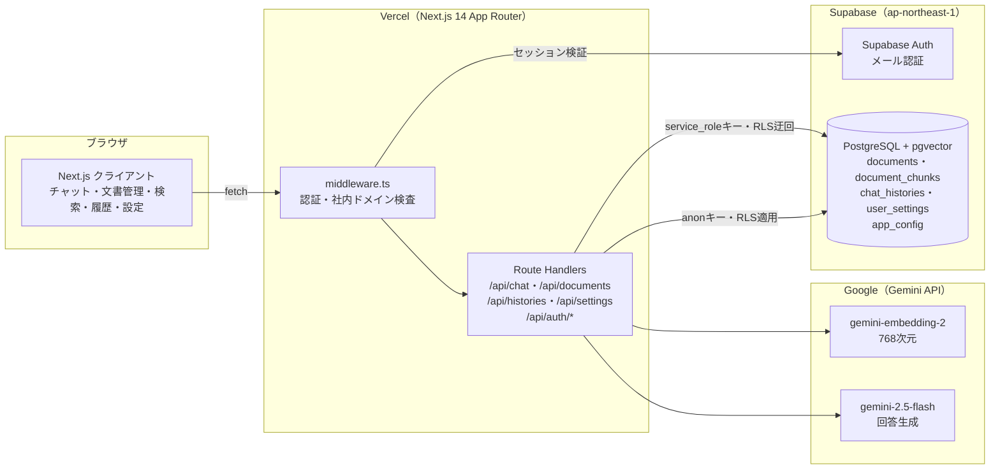
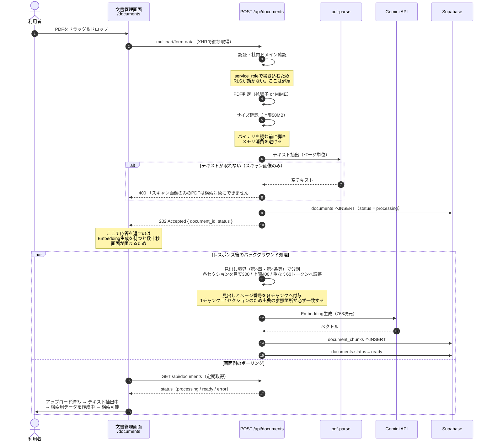
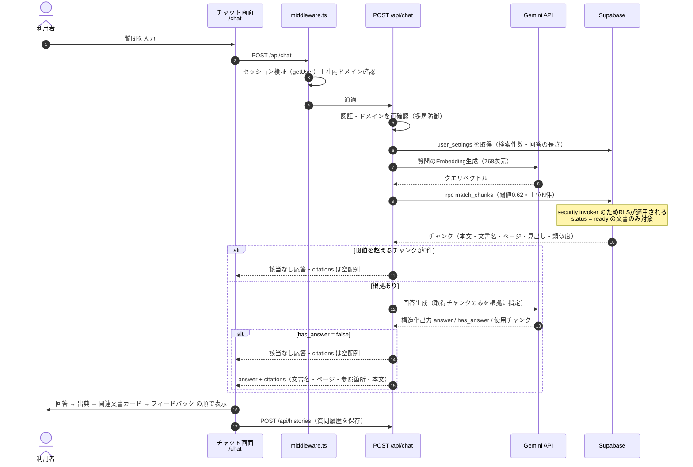
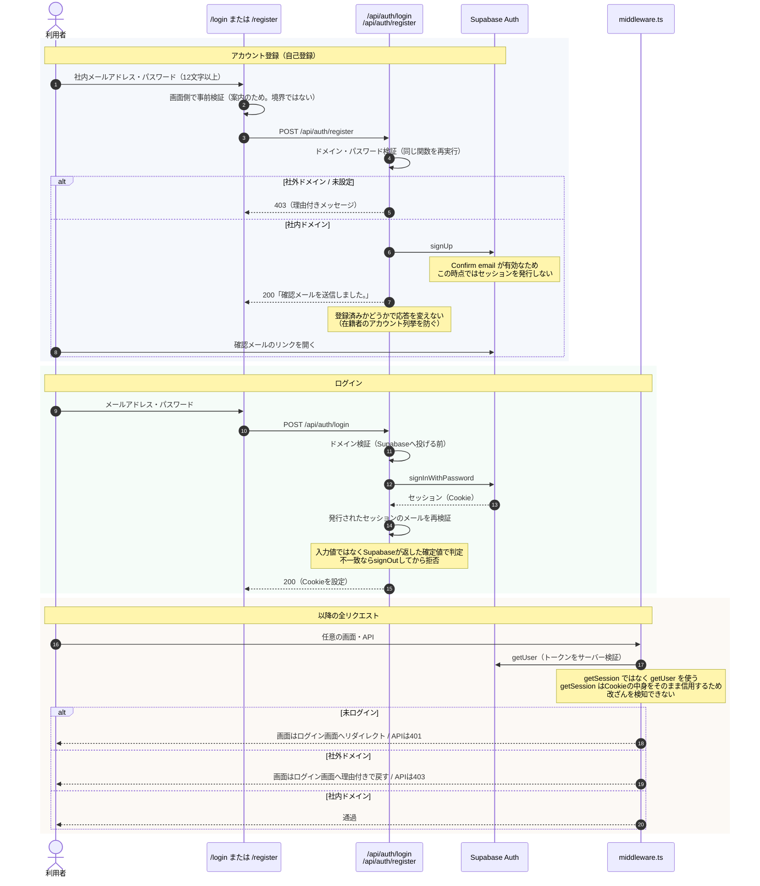
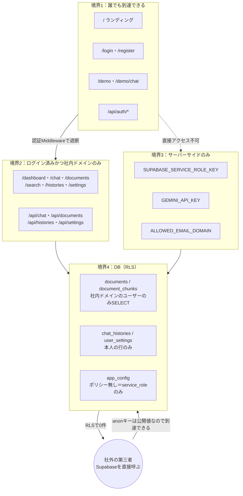
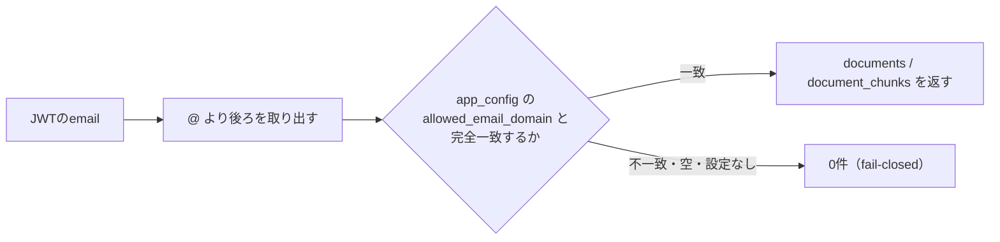
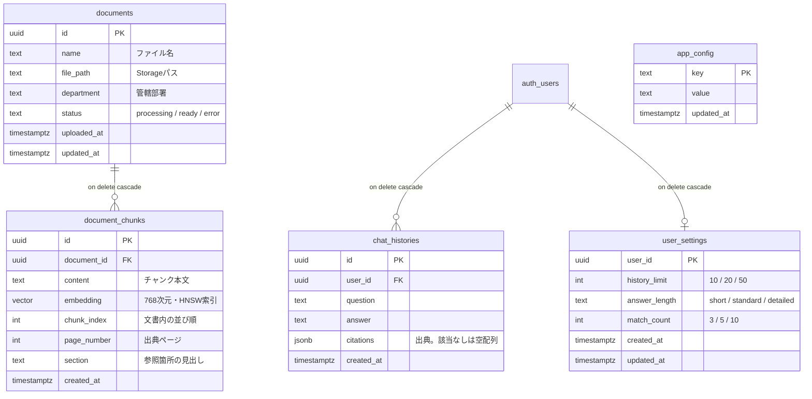

# アーキテクチャ詳細

社内文書検索AI（RAG）MVP　従業員約50名の企業向け受託開発案件

## このドキュメントで分かること

1. **技術的な構成の全体像** — どのサービスが何を担当し、どう連携しているか
2. **データがどこに保存されるか** — テーブル構成と、社外へ出ていく情報の範囲
3. **セキュリティの仕組み** — 認証・社内ドメイン制限・RLSがどこで効いているか

> **このドキュメントは開発者向けです。**
> 運用担当者は [operations.md](operations.md)、
> 情報システム部門向けの説明資料は [system-overview.md](system-overview.md)、
> 次フェーズの提案は [phase2-proposal.md](phase2-proposal.md) を参照してください。
> 概要は [../README.md](../README.md) にあります。

---

## 目次

| # | 章 | 内容 |
|---|---|---|
| 1 | [全体構成](#1-全体構成) | 構成図と外部サービス |
| 2 | [API一覧](#2-api一覧) | エンドポイントと認証要否 |
| 3 | [文書取り込みフロー](#3-文書取り込みフロー) | PDF登録から検索可能になるまで |
| 4 | [検索・回答フロー](#4-検索回答フロー) | 質問から回答表示まで |
| 5 | [認証フロー](#5-認証フロー) | 登録・ログイン・毎リクエストの検査 |
| 6 | [セキュリティ境界](#6-セキュリティ境界) | 4つの境界と守り方 |
| 7 | [データモデル](#7-データモデル) | テーブル構成とRLS |
| 8 | [主要な設定値](#8-主要な設定値) | チャンキング・検索・上限値 |
| 9 | [技術選定の理由](#9-技術選定の理由) | なぜこれを選んだか |
| 10 | [ディレクトリ構成](#10-ディレクトリ構成) | ソースの置き場所 |

---

## 用語

初出の専門用語を1行で説明します。

| 用語 | 意味 |
|---|---|
| **RAG** | 検索拡張生成。AIに答えさせる前に、社内文書から関連箇所を検索して根拠として渡す方式 |
| **チャンク** | 文書を検索しやすい単位へ分割した文章の断片。1件＝1チャンク |
| **Embedding** | 文章を意味の近さで比較できる数値の並び（ベクトル）へ変換したもの |
| **pgvector** | PostgreSQLでベクトルを保存・検索するための拡張機能 |
| **HNSW** | ベクトル検索を高速化する索引の方式。総当たりせずに近いものを探す |
| **RLS** | 行レベルセキュリティ。「誰がどの行を読めるか」をデータベース自身が判定する仕組み |
| **anonキー** | ブラウザへ配布される公開用の接続キー。RLSが効く前提で使う |
| **service_roleキー** | RLSを迂回する管理用キー。サーバー側のみで使用する |
| **JWT** | ログイン時に発行される署名付きのトークン。メールアドレス等の情報を含む |

---

## 1. 全体構成



**外部へ出ていくデータは、Gemini APIへ送る「質問文」と「検索でヒットしたチャンク本文」のみです。**
文書ファイルそのものはGeminiへ送りません（テキスト抽出・分割はサーバー側で行います）。

---

## 2. API一覧

すべて Next.js の Route Handler（`src/app/api/`）で実装しています。

| エンドポイント | メソッド | 役割 | 認証 | 社内ドメイン確認 |
|---|---|---|---|---|
| `/api/auth/login` | POST | ログイン（セッションCookieを発行） | 不要 | 実施（入力値＋発行後の再確認） |
| `/api/auth/register` | POST | 社内メールでの自己登録 | 不要 | 実施 |
| `/api/chat` | POST | 質問 → 検索 → 回答生成 | 必要 | 実施 |
| `/api/documents` | GET | 登録済み文書の一覧（部署・キーワードで絞り込み可） | 必要 | 実施 |
| `/api/documents` | POST | PDFの取り込み開始（202を即返す） | 必要 | 実施 |
| `/api/documents` | DELETE | 文書とチャンクの削除 | 必要 | 実施 |
| `/api/histories` | GET | 本人の質問履歴の取得 | 必要 | 実施 |
| `/api/histories` | POST | 質問履歴の保存 | 必要 | 実施 |
| `/api/settings` | GET | 本人の設定の取得（未保存なら既定値） | 必要 | 実施 |
| `/api/settings` | PUT | 設定の保存 | 必要 | 実施 |

### 認証まわりの補足

| 項目 | 内容 |
|---|---|
| 認証の実施箇所 | Middleware（全リクエスト）＋ 各Route Handler内（多層防御） |
| 未ログイン時の応答 | `/api/*` は401をJSONで返す（画面はログイン画面へリダイレクト） |
| 社外ドメイン時の応答 | 403（ログイン済みだが権限が無いことをUIが区別できるようにするため） |
| `/api/auth/*` が公開の理由 | 未ログインで呼べる必要があるため。**この配下に社内データを返すエンドポイントを置かないこと** |

**【重要】** `/api/documents` の POST と DELETE は `service_role` キーで書き込むため **RLSが効きません**。
Route Handler内の認証・ドメイン確認を外すと、書き込み口がそのまま開きます。

### レート制限

| 対象 | 上限 | 応答 |
|---|---|---|
| `POST /api/chat` | 1分間に5回 / ユーザー | 429 ＋ `Retry-After` ヘッダー |

- Gemini無料枠（毎分5回）に合わせています
- 判定キーはSupabaseが検証済みのユーザーID（IPだと社内NATで全員が同一IPになり、1人の連打で全員が止まるため）
- **【注意】** Vercelでは実行インスタンスごとにカウントが独立します。厳密な制限が必要な場合は共有ストア（Upstash Redis等）へ移す必要があります

---

## 3. 文書取り込みフロー



### 失敗時の扱い

| 失敗箇所 | 利用者への見え方 |
|---|---|
| PDF以外のファイル | 即座にエラー（アップロードされない） |
| 50MB超 | 即座にエラー |
| テキスト抽出不可 | 即座にエラー（スキャンPDFの案内） |
| Embedding生成の失敗 | 文書一覧の状態が「エラー」になる。削除して再アップロードする |

Embedding生成はレスポンス後に走るため、この失敗だけは画面上で即座には分かりません。
文書一覧の状態表示で確認する設計にしています。

---

## 4. 検索・回答フロー



### ハルシネーション抑制が二重になっている理由

| 段階 | 仕組み | 止められるもの |
|---|---|---|
| 検索 | 類似度閾値0.62未満のチャンクを捨てる | 明らかに無関係な質問 |
| 生成 | プロンプトで「取得文書のみを根拠に」と制約し、根拠が無ければ `has_answer = false` を返させる | 閾値は超えたが実際には答えが書かれていない場合 |

精度検証では、文書に記載のない質問の最高類似度が0.646と閾値0.62を上回っていました。
つまり**検索段階だけでは文書外の質問を止めきれておらず、生成段階の判断が実際の防波堤として機能しています**。
閾値を利用者が変更できる設定項目に含めていないのは、この防御を緩められないようにするためです。

---

## 5. 認証フロー



### 公開パス（未ログインでアクセスできる範囲）

| パス | 内容 | 社内文書を扱うか |
|---|---|---|
| `/` | ランディングページ（完全一致のみ） | 扱わない |
| `/login`・`/register` | ログイン・アカウント登録 | 扱わない |
| `/api/auth/*` | ログインAPI・登録API | 扱わない |
| `/demo`・`/demo/chat` | BYOKデモ | 扱わない（公開してよいサンプル文書のみ） |
| `/auth/callback`・`/auth/confirm` | 認証コールバック用に予約 | 扱わない |

**この一覧へパスを追加するときは、必ず「未ログインの相手に見せてよいか」を確認してください。**
`/api/auth` は前方一致で公開されるため、この配下に社内データを返すエンドポイントを置いてはいけません。

### BYOKデモの位置づけ

`/demo` は営業・確認用のデモで、次の点で本番経路と異なります。

- Gemini APIを**ブラウザから直接**呼びます。サーバーもDBも経由しません
- 利用者が入力したAPIキーはsessionStorageにのみ保持し、タブを閉じると消えます。サーバーへは送信しません
- ベクトル検索を行わず、サンプル5文書の全文をプロンプトへ渡します
- したがって**精度検証の数値（回答精度100%）はデモには当てはまりません**

---

## 6. セキュリティ境界



### 境界ごとの守り方

| 境界 | 守っているもの | 破られたときに起きること |
|---|---|---|
| 1→2 認証Middleware | 未ログイン・社外ドメインの遮断 | 社内文書が誰でも読める |
| 各API内の再確認 | Middlewareの設定漏れへの備え | 公開パス設定を1行間違えるだけで書き込み口が開く |
| 3 環境変数 | `service_role` キー・Gemini APIキー・許可ドメイン | キー漏洩で全データへ外部からアクセス可能になる |
| 4 RLS | アプリを経由しない直接アクセス | anonキーは公開値のため、アプリのチェックだけでは塞げない |

### なぜRLSにもドメイン判定が必要なのか

**理由：anonキーは公開値のため、アプリを経由しない経路が成立するから。**

| # | 攻撃の手順 | アプリのチェックは効くか |
|---|---|---|
| 1 | 任意のアドレス（例：`attacker@gmail.com`）でSupabaseへ直接サインアップ | 効かない（アプリを通らない） |
| 2 | 自分宛の確認メールを開き、認証済みトークンを得る | 効かない |
| 3 | `https://<project>.supabase.co/rest/v1/document_chunks?select=*` を直接呼ぶ | 効かない |

**【重要】この経路はPhase DELのレビューで実際に検証済みです。**
MVP初期のRLSは `to authenticated using (true)`（＝Supabaseにログイン済みなら誰でも全文書を読める）で、
社外ドメインのトークンで全5文書・16チャンクが取得できる状態でした。

現在は `public.is_internal_user()` により、JWTのメールドメインが
`app_config.allowed_email_domain` と**完全一致**する場合のみSELECTを許可しています。



- 完全一致にしているのは、後方一致だと `evilexample.co.jp` のような取得可能な類似ドメインを通してしまうためです（アプリ側の `src/lib/auth/emailDomain.ts` と同じ考え方）
- サブドメイン（`mail.example.co.jp`）も別ドメインとして拒否します
- 設定が無い場合は0件を返します（fail-closed）。設定漏れで社外へ出すより、全員が使えない方が異常に気付けるためです
- `app_config` はRLSを有効にしたうえでポリシーを1つも作っていないため、`anon`・`authenticated` からは読めません。判定関数を `security definer` にすることで、関数の所有者権限だけが参照できます

### 許可ドメインが2か所にある理由と同期

| 場所 | 用途 | 更新方法 |
|---|---|---|
| 環境変数 `ALLOWED_EMAIL_DOMAIN` | アプリ側（Middleware・API）の判定 | `.env.local` / Vercelの環境変数 |
| `app_config.allowed_email_domain` | DB側（RLS）の判定 | `npm run sync:allowed-domain` |

- DBは環境変数を読めないため、値が2か所に分かれます
- 同期スクリプトが「環境変数 → DB」の**一方向同期**を行い、ずれを防ぎます

**【重要】ドメインを変更したら必ず `npm run sync:allowed-domain` を実行してください。**
実行し忘れると、アプリは通すのにDBが弾き、**「ログインはできるが文書が0件」**という
原因の分かりにくい状態になります。

---

## 7. データモデル

### テーブル一覧

| テーブル名 | 役割 | 主なカラム | 備考 |
|---|---|---|---|
| `documents` | 検索対象の社内文書（1文書＝1行） | `name`／`department`／`status`／`uploaded_at` | `status` は `processing`／`ready`／`error` の3値。`ready` のみ検索対象 |
| `document_chunks` | 文書を分割した本文とEmbedding | `document_id`／`content`／`embedding`／`chunk_index`／`page_number`／`section` | `embedding` は768次元。`document_id` は文書削除時に連動削除（cascade） |
| `chat_histories` | 利用者ごとの質問・回答履歴 | `user_id`／`question`／`answer`／`citations` | **本人以外は参照不可**。UPDATEポリシーを作らず、後から書き換えられない |
| `user_settings` | 利用者ごとの表示・検索設定 | `user_id`（主キー）／`history_limit`／`answer_length`／`match_count` | 1ユーザー1行。行が無い場合は既定値として扱う |
| `app_config` | サーバー側だけが読む設定値 | `key`／`value` | 現在は許可メールドメインのみ。**RLSでanon・authenticatedからは全拒否** |

**【重要】** 類似度の閾値は `user_settings` に含めていません。
ハルシネーション抑制の要であり、利用者が緩められてはならないためコード側の定数（0.62）で固定しています。




### RLSポリシー一覧

| テーブル | SELECT | INSERT | UPDATE | DELETE |
|---|---|---|---|---|
| `documents` | 社内ドメインのユーザー | なし | なし | なし |
| `document_chunks` | 社内ドメインのユーザー | なし | なし | なし |
| `chat_histories` | 本人のみ | 本人のみ | **なし（意図的）** | 本人のみ |
| `user_settings` | 本人のみ | 本人のみ | 本人のみ | なし |
| `app_config` | **なし** | なし | なし | なし |

ポリシーが「なし」の操作は、`service_role`（サーバーサイド）からのみ実行できます。

- 文書の取り込み・削除は `service_role` で行います。RLSを迂回するため、APIハンドラ側で認証と社内ドメインを必ず確認しています
- `chat_histories` にUPDATEポリシーを作っていないのは、「いつ何を聞いたか」の記録を後から書き換えられないようにするためです

### 検索用RPC

```sql
match_chunks(query_embedding vector(768), match_threshold float, match_count int)
```

- `security invoker`（呼び出したユーザーの権限で実行）のため、上記のRLSがそのまま適用されます
- 実行権限は `authenticated` と `service_role` のみ（`public` からはrevoke済み）
- `documents.status = 'ready'` の文書だけを対象にします（取り込み中・失敗した文書は検索に出ません）
- 出典表示に必要な文書名・ページ番号・参照箇所を同時に返すため、DBへの往復は1回で済みます

---

## 8. 主要な設定値

### チャンキング設定

| 項目 | 設定値 | この値にした理由 |
|---|---|---|
| 分割方式 | **見出し境界**（第○章・第○条・1.2.3 等）で分割し、各セクションを目標トークン数へ調整 | 文字数だけで機械的に分割すると1チャンクに複数の章が混ざり、出典の参照箇所が実際の該当箇所とずれる。1チャンク＝1セクションにすることで出典が必ず一致する |
| 目安トークン数 | 300 | requirements.md が定める300〜500トークンの範囲内で、分離度が最も良かった値 |
| 上限トークン数 | 400 | 大きくすると無関係な文脈が混ざり、回答精度が落ちる |
| 重なり（オーバーラップ） | 60トークン | 文の途中や箇条書きの途中で切れた場合に、前後の文脈を失わないようにするため |
| ページ番号の保持 | あり | 出典表示（F-04）で「文書名＋ページ番号」を示すため |
| 見出しの保持 | あり（`section` カラム） | 出典の「参照箇所」に使う。見出しの無いセクションは前ページの見出しを引き継ぐ |

**【注意】** 分割方式・トークン数を変更すると、**全文書の再取り込みが必要**です。
文書を大量に登録した後の変更はコストが大きくなります。

### 検索・生成の設定

| 項目 | 設定値 | この値にした理由 |
|---|---|---|
| Embeddingモデル | `gemini-embedding-2` | 変更すると全文書の再取り込みが必要 |
| Embedding次元数 | **768** | pgvectorのHNSW索引は最大2000次元まで。指定しないと3072次元が返り、`vector(768)` と不一致になる |
| ベクトル索引 | HNSW（コサイン距離） | 総当たりせずに近いベクトルを探せる |
| 類似度閾値 | **0.62** | 正解チャンクの類似度は平均0.68で、0.7では正解が弾かれる。実測に基づく値（[精度検証レポート](validation/rag-accuracy-report.md)） |
| 取得チャンク数 | 既定5件（設定画面で3 / 5 / 10） | 多いほど材料は増えるが、無関係な文脈が混ざる |
| 回答生成モデル | `gemini-2.5-flash` | 模擬案件のコスト都合。本番採用は未確定 |

**【重要】** 類似度閾値はハルシネーション抑制の要です。
下げると文書外の質問が検索を通過するため、変更は精度検証の結果を根拠に行ってください。

### 上限値

| 項目 | 値 | 備考 |
|---|---|---|
| PDFサイズ上限（アプリ） | 50MB | |
| リクエストボディ上限（Vercel） | **4.5MB** | プラットフォーム側の制限。50MB以下でもVercel上では4.5MBを超えると失敗する |
| 質問の最大文字数 | 1,000文字 | 履歴保存時に切り詰め |
| 回答の最大文字数 | 10,000文字 | 同上 |
| 履歴の取得件数 | 既定50件・最大100件 | |

---

## 9. 技術選定の理由

| 技術 | 採用理由 | 代替案 |
|---|---|---|
| **Next.js 14（App Router）** | 画面とAPIを1つのプロジェクトで扱える。Middlewareで全リクエストの認証をまとめて行える | Remix / SvelteKit。分離構成（React + 別APIサーバー）も可能だが、認証の実装が2か所に分かれる |
| **Supabase（PostgreSQL + pgvector）** | 認証・DB・ベクトル検索を1サービスで賄える。**東京リージョンを選択できる**。RLSでDB自身にアクセス制御を持たせられる | 専用ベクトルDB（Pinecone / Qdrant）＋別の認証基盤。構成要素が増え、リージョン管理も分散する |
| **pgvector（HNSW索引）** | 文書本文とベクトルを同じDBに置けるため、検索1回で出典情報まで取得できる | 専用ベクトルDB。文書メタデータとの結合に往復が増える |
| **Embedding 768次元** | pgvectorのHNSW索引は最大2000次元。768なら索引が使える | 3072次元（既定値）。精度は上がりうるが索引が張れず検索が遅くなる |
| **Gemini API（`gemini-2.5-flash`）** | **模擬案件のAPIコスト節約のため**。本番採用は未確定 | Claude API / Azure OpenAI（日本リージョン）/ 国内ホスティング。詳細は [phase2-proposal.md](phase2-proposal.md) 5章 |
| **pdf-parse** | ページ単位でテキストを取り出せるため、出典のページ番号を正確に示せる | LangChain の document_loaders。依存が増える割にMVPでは利点が少ない |
| **CSS Modules** | クラス名の衝突を防げる。追加の依存やビルド設定が不要 | Tailwind CSS / CSS-in-JS。UX仕様書のデザイントークンをCSS変数で一元管理する方針と相性が良いのはCSS変数＋CSS Modules |
| **Vercel** | Next.jsの標準的なデプロイ先。設定が最小限で済む | AWS Amplify / Cloud Run。**本番でリージョン要件が出た場合は再検討が必要** |
| **インメモリのレート制限** | 目的はGemini無料枠の使い切り緩和であり、外部からの攻撃対策ではない。外部ストアを増やさずに済む | Upstash Redis 等の共有ストア。厳密な制限が必要になった時点で移行する |

**【重要】Gemini APIの採用は確定ではありません。**
本番導入前に、外部送信の可否・処理リージョン・データ利用条件・コストの再評価が必要です。
判断を変える場合は必ずクライアント確認を取ってください。

---

## 10. ディレクトリ構成

```
src/
├── app/
│   ├── api/            APIルート（chat・documents・histories・settings・auth）
│   ├── (各画面)/        dashboard・chat・documents・search・histories・settings・login・register・demo
│   └── page.tsx        ランディング
├── components/         画面別コンポーネント（CSS Modules同梱）
├── lib/
│   ├── auth/           ドメイン判定・登録規則・ログインエラー変換
│   ├── gemini/         Embedding生成・回答生成
│   ├── ingest/         取り込みパイプライン
│   ├── pdf/            テキスト抽出・チャンク分割・エラー定義
│   ├── search/         クエリEmbedding・ベクトル検索
│   ├── supabase/       クライアント生成（browser / server / admin）
│   └── demo/           BYOKデモ専用
├── middleware.ts       認証・社内ドメイン検査
└── types/              API・チャット・アップロードの型定義

supabase/migrations/    DBスキーマ（適用はファイル名の昇順）
scripts/                検証・セットアップ用スクリプト
docs/                   本ドキュメント・運用手順・Phase 2提案・精度検証結果
```
