# 運用手順書

社内文書検索AI（RAG）　運用担当者の方向け

このドキュメントは、システムを実際に運用される担当者の方向けの手順書です。
専門知識がなくても操作できるように書いています。

---

## 目次

0. **[【やってはいけない】最初に必ず読んでください](#やってはいけない最初に必ず読んでください)**
1. [このシステムでできること](#1-このシステムでできること)
2. [ログイン方法](#2-ログイン方法)
3. [新しいPDFを登録する](#3-新しいpdfを登録する)
4. [文書を更新するときの考え方](#4-文書を更新するときの考え方)
5. [文書を削除する](#5-文書を削除する)
6. [AIの回答を確認する](#6-aiの回答を確認する)
7. [回答がおかしいときの切り分け手順](#7-回答がおかしいときの切り分け手順)
8. [よくあるエラーと対処](#8-よくあるエラーと対処)
9. [APIキー・環境変数の管理方針](#9-apiキー環境変数の管理方針)
10. [日常運用のチェックリスト](#10-日常運用のチェックリスト)
11. [使い方ガイド（社員向け）](#11-使い方ガイド社員向け)
12. [APIキー設定ガイド（管理者向け）](#12-apiキー設定ガイド管理者向け)
13. [トラブルシューティング](#13-トラブルシューティング)
14. [検索用データ（Embedding）の再生成とコスト](#14-検索用データembeddingの再生成とコスト)

---

## 【やってはいけない】最初に必ず読んでください

以下は、**実行すると情報漏洩・データ消失・システム停止につながる操作**です。

| # | やってはいけないこと | 何が起きるか |
|---|---|---|
| 1 | Supabaseの **「Confirm email」を無効化しない** | 社内アドレスを騙って登録した相手が、そのまま社内文書を閲覧できるようになります |
| 2 | **APIキーをメール・チャット・共有ファイルで送らない** | 送信履歴に残り続けます。管理キーが漏れると社内文書の全データを外部から読み書きされます |
| 3 | **部署別アクセス制御の導入前に、機密文書を登録しない** | 現在はログインした社員全員が全文書を検索できます。人事評価・給与などを登録すると全社員が閲覧できます |
| 4 | **`.env.local` ファイルをGitへ登録しない** | リポジトリに鍵が残り、履歴からも復元できてしまいます |
| 5 | **削除ボタンを確認せずに押さない** | 文書と検索用データが完全に消えます。取り消せません |
| 6 | **`ALLOWED_EMAIL_DOMAIN` を変更したまま同期コマンドを実行しないまま放置しない** | 「ログインはできるのに文書が1件も出ない」状態になります（[9章](#9-apiキー環境変数の管理方針)） |
| 7 | **担当者の異動・退職時に鍵を再発行せずに放置しない** | 退職者が社内文書へアクセスできる状態が残ります |

**判断に迷ったら、操作する前に開発担当者へご相談ください。**

---

## 1. このシステムでできること

> この章で分かること：このシステムで**できること・できないこと**

社員が「チャットで質問する」と、登録済みの社内PDFを根拠にAIが回答します。

| できること | できないこと（現時点） |
|---|---|
| PDFを登録して検索対象にする | Word・Excel・Confluenceの登録 |
| 質問への回答と、その根拠（文書名・ページ）の表示 | 部署ごとに見える文書を分けること |
| 社内文書に書かれていない質問への「該当なし」応答 | 紙をスキャンしただけのPDF（画像のみ）の読み取り |
| 自分の質問履歴の確認 | 他の社員の質問履歴の確認 |
| 登録済み文書の一覧・絞り込み・削除 | 文書の自動更新・自動同期 |

**社外の方はこのシステムを利用できません。**
社内メールアドレス以外では、ログインも文書の閲覧もできない設定になっています。

---

## 2. ログイン方法

> この章で分かること：**初めて使う人の登録手順**と、ログインできないときの対処

### 初めて使う社員の場合（アカウント登録）

**準備すること**

| # | 準備 |
|---|---|
| 1 | 社内メールアドレス（このアドレス以外では登録できません） |
| 2 | 12文字以上のパスワード |
| 3 | 社内メールを受信できる状態（確認メールが届きます） |

**手順**

1. ブラウザで社内文書検索AIのURLを開きます
2. 画面右上の **「ログイン」** を押します
3. ログイン画面の下にある **「アカウントを登録する」** を押します
4. **社内メールアドレス**とパスワード（12文字以上）を入力します
5. **「登録する」** を押します
6. 「確認メールを送信しました。」と表示されます
7. **社内メールの受信ボックスを開き、確認メールのリンクを押します**

**確認すること**

| # | 確認 | 正常な状態 |
|---|---|---|
| 1 | 確認メールが届いたか | 届かない場合は迷惑メールフォルダを確認 |
| 2 | リンクを開いた後にログインできるか | ログイン画面からログインできる |

> **確認メールのリンクを押すまではログインできません。**
> これは「社内メールを受け取れる人だけが使える」ようにするための仕組みです。
> 迷惑メールフォルダに入っていることがありますので、届かない場合はご確認ください。

### 2回目以降

1. ログイン画面でメールアドレスとパスワードを入力します
2. **「ログイン」** を押します
3. ダッシュボード画面が表示されます

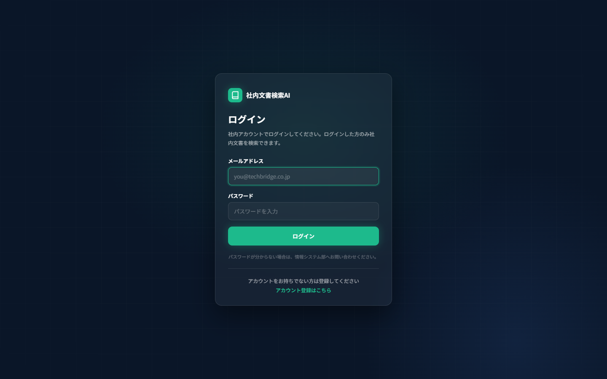

ログイン後は、ダッシュボードが表示されます。
よく使う操作・直近の質問履歴・文書の状態がこの1画面で確認できます。

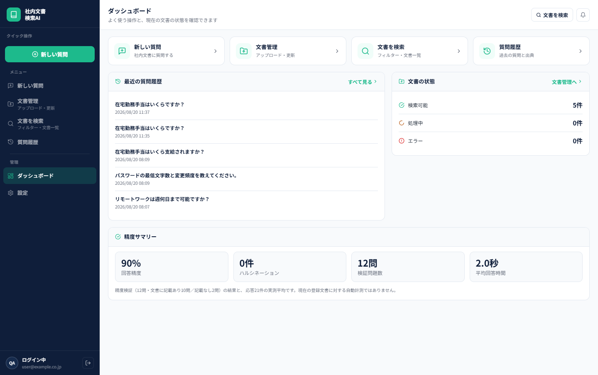

### ログインできないとき

| 表示されるメッセージ | 原因 | 対処 |
|---|---|---|
| このメールアドレスではログインできません | 社内メールアドレスではない | 社内メールアドレスでログインしてください |
| メールアドレスまたはパスワードが違います | 入力ミス、または未登録 | 入力内容を確認してください。未登録の場合は先にアカウント登録を行ってください |
| ログイン設定が未完了のためログインできません | システム側の設定漏れ | 利用者側では解決できません。システム管理者へご連絡ください |

---

## 3. 新しいPDFを登録する

> この章で分かること：**PDFを検索できる状態にするまで**の手順と、登録できるPDFの条件

### 準備すること

| # | 準備 | 確認方法 |
|---|---|---|
| 1 | 登録するPDFを手元に用意する | 下記「登録できるPDFの条件」を満たしているか |
| 2 | 社内メールアドレスでログインしておく | 画面左下にご自身のアドレスが表示されていればログイン済み |
| 3 | **同じ文書がすでに登録されていないか確認する** | 「文書管理」の一覧を確認。すでにある場合は[4章の更新手順](#4-文書を更新するときの考え方)へ |

### 手順

1. 画面左のメニューから **「文書管理」** を押します
2. 画面上部の **「PDFアップロード」** エリアを使います
3. 次のどちらかの方法でPDFを選びます
   - PDFファイルをエリアの中へ**ドラッグ＆ドロップ**する
   - **「ファイルを選択」** を押して、PDFを選ぶ

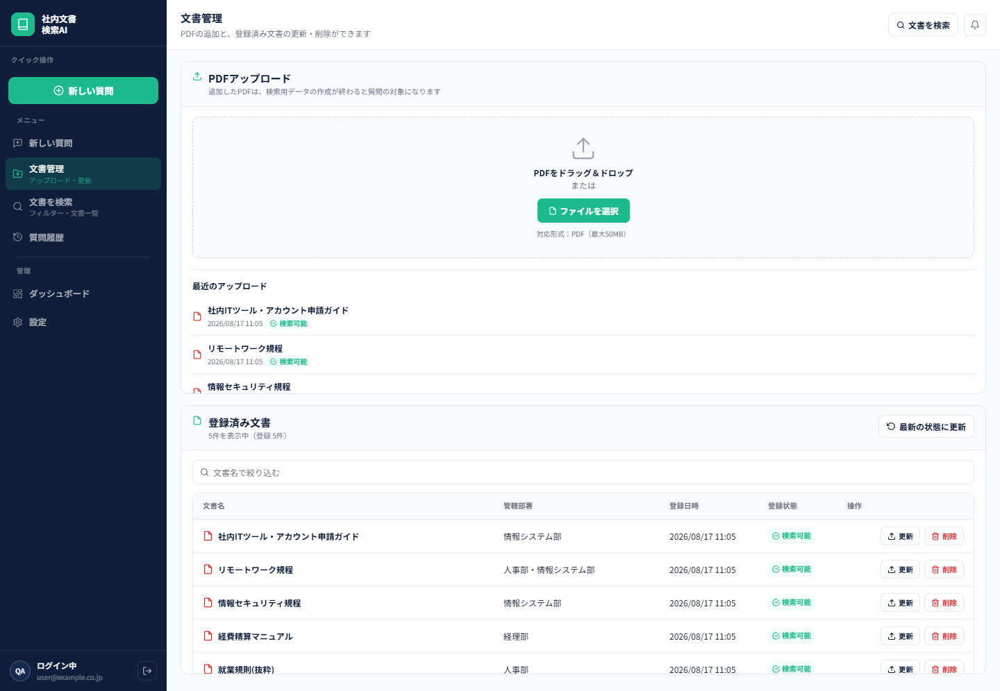

上部が「PDFアップロード」、下部が「登録済み文書」の一覧です。
一覧の右端に、各文書の **「更新」「削除」** ボタンがあります。

4. 処理状況が次の順で進みます

   | 表示 | 内容 |
   |---|---|
   | アップロード済み | ファイルの送信が完了しました |
   | テキスト抽出中 | PDFから文字を読み取っています |
   | 検索用データを作成中 | AIが検索できる形に変換しています（時間がかかるのはここです） |
   | **検索可能** | 完了です。この文書に対して質問できます |

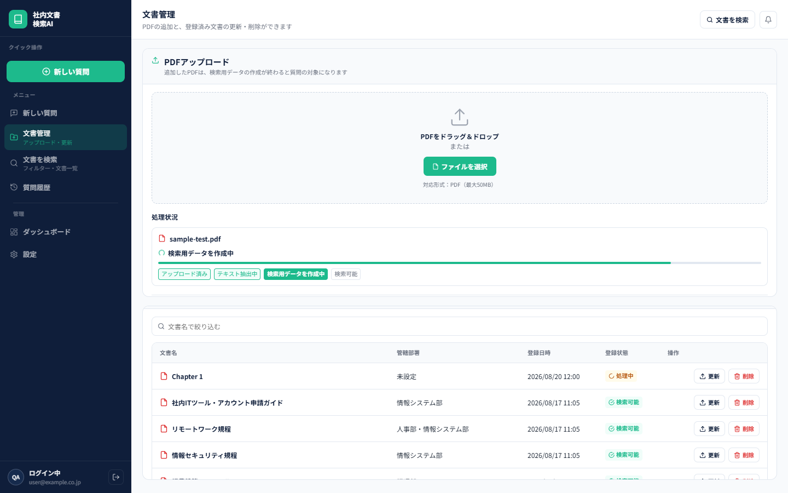

### 確認すること

| # | 確認 | 正常な状態 |
|---|---|---|
| 1 | 一覧の「登録状態」 | **「検索可能」** になっている |
| 2 | 一覧の件数 | 同じ文書が2件になっていない |
| 3 | 実際に質問してみる | その文書の内容について質問し、正しく回答されること |

> **「検索用データを作成中」は数分かかることがあります。**
> 画面を閉じても処理は続きます。あとで文書管理画面を開き直して、
> 一覧の登録状態が「検索可能」になっているか確認してください。

### 登録できるPDFの条件

| 条件 | 内容 |
|---|---|
| 形式 | PDFのみ |
| サイズ | 50MBまで（※インターネット公開環境では4.5MBまで。下の注意を参照） |
| 中身 | **文字が選択できるPDF**であること |

> **紙をスキャンしただけのPDFは登録できません。**
> スキャンPDFは中身が「画像」のため、文字を読み取れません。
> PDFを開いて文字をマウスで選択できるかどうかで判別できます。
> 選択できない場合は、元のWord等からPDFを作り直してください。

> **インターネット公開環境（Vercel）では、4.5MBを超えるPDFはアップロードできません。**
> これは公開基盤側の上限です。大きなPDFを登録する必要がある場合は、
> 開発担当者へご相談ください（分割するか、別方式への変更が必要です）。

---

## 4. 文書を更新するときの考え方

> この章で分かること：規程を改訂したときの**正しい入れ替え手順**

### 基本の考え方

このシステムは**文書の自動更新を行いません**。
規程やマニュアルを改訂したら、**担当者が手動で入れ替える**必要があります。

AIは「登録されている文書」だけを根拠に回答します。
つまり**古い版が登録されたままだと、AIは古い内容で答えます。**
ここが運用上もっとも重要な点です。

### 更新の手順

**一覧の「更新」ボタンを使ってください。古い内容は自動的に置き換わります。**

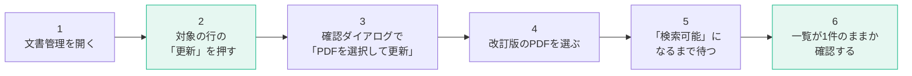

#### STEP 1・2　対象の行の「更新」を押す

「文書管理」画面を開き、更新したい文書の行にある **「更新」** を押します。
**同じ行の右隣にある「削除」と間違えないよう注意してください。**

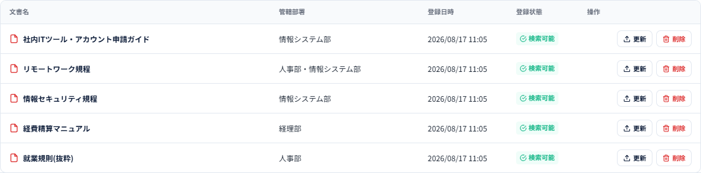

| ボタン | 何が起きるか |
|---|---|
| **更新**（グレー） | 新しいPDFを選び、**その文書の中身を置き換える**。文書は増えない |
| **削除**（赤） | その文書と検索用データを**完全に消す**。取り消せない |

#### STEP 3　確認ダイアログの内容を読む

**「PDFを選択して更新」** を押すと、ファイル選択画面が開きます。
やめる場合は「キャンセル」を押してください。

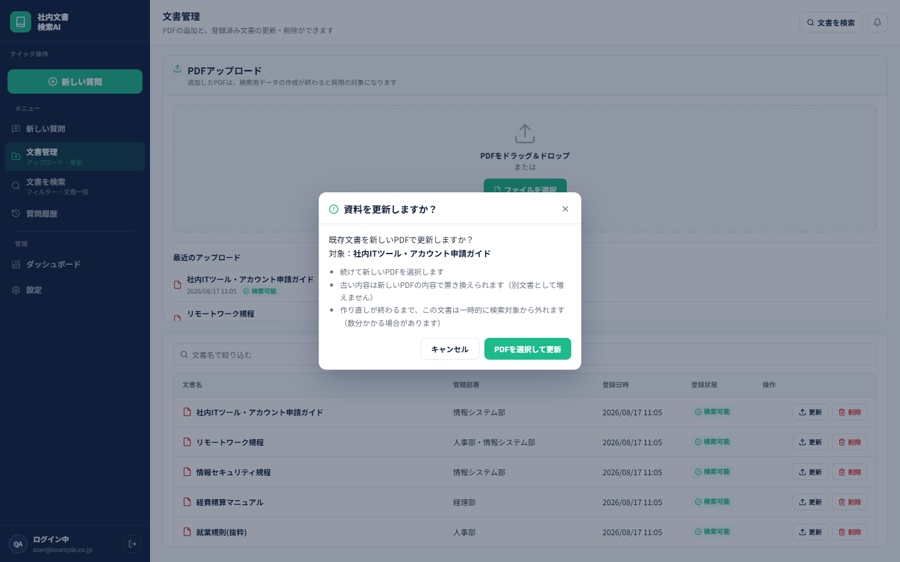

#### STEP 4・5　PDFを選び、処理の完了を待つ

改訂版のPDFを選ぶと、画面上部に処理状況が表示されます。
**「検索可能」** になれば完了です。


| 表示 | 内容 |
|---|---|
| アップロード済み | ファイルの送信が完了しました |
| テキスト抽出中 | PDFから文字を読み取っています |
| 検索用データを作成中 | AIが検索できる形に変換しています（時間がかかるのはここです） |
| **検索可能** | 完了です |

処理中は、一覧のその文書の登録状態が **「処理中」** になります。

#### STEP 6　一覧を確認する

一覧に戻り、**その文書が1件だけ**で、登録状態が **「検索可能」** になっていることを確認します。


> **「更新」を使えば、古い版を削除する必要はありません。**
> 選んだ文書の中身が新しいPDFの内容で置き換わるため、同じ文書が2件に増えることはありません。
> 改訂でPDFのタイトルが変わっていても（例：「就業規則」→「就業規則 2026年改訂版」）、
> 選んだ文書がそのまま置き換わります。

> **作り直しの間、その文書は一時的に検索対象から外れます。**
> 登録状態が「検索可能」に戻るまでは、その文書に関する質問に
> 「該当する情報を社内文書から確認できませんでした。」と返ることがあります。
> 数分で完了します。

### 「更新」を使わずアップロードした場合

「PDFアップロード」エリアから直接アップロードした場合は、
**PDFのタイトル行が既存の文書と同じであれば置き換わり、違えば別文書として追加されます。**

改訂でタイトルを変えたPDFをここから登録すると、古い版が残って2件並びます。
その状態ではAIが古い方を根拠に答えることがあるため、
**一覧を確認し、古い版を「削除」してください。**

こうした取り違えを避けるため、**改訂版の登録には必ず「更新」ボタンを使ってください。**

### 更新のタイミングの目安

| 状況 | 対応 |
|---|---|
| 規程・マニュアルを改訂した | その都度、一覧の「更新」から新しい版を登録する |
| 一部の表現だけ直した | 同上（差分だけの反映はできないため、PDF全体を登録し直します） |
| 文書を廃止した | 「削除」を行う |
| 誤って同じ文書を2件登録してしまった | 古い方を「削除」する |
| 月次でまとめて確認したい | 月に一度、一覧と実際の最新版を突き合わせる運用を推奨します |

---

## 5. 文書を削除する

> この章で分かること：文書の**削除手順**と、削除すると何が起きるか

1. 「文書管理」画面を開きます
2. 一覧から削除したい文書の **「削除」** を押します
3. 確認ダイアログの内容を読み、**「削除する」** を押します

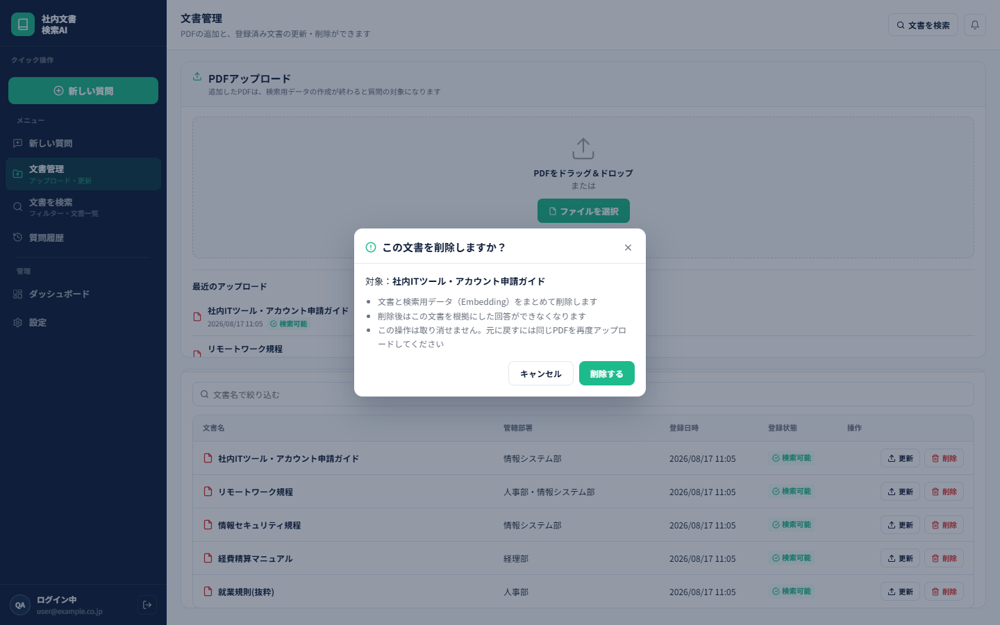

削除すると、その文書と検索用データがまとめて消えます。
以降、その文書を根拠にした回答はできなくなります。

> **削除は取り消せません。**
> 元に戻すには、同じPDFを再度アップロードする必要があります。

---

## 6. AIの回答を確認する

> この章で分かること：**回答の見方**と、根拠（出典）の確認方法

### 回答の見方

AIの回答は、上から順に次の要素で構成されています。

1. **回答本文** — 質問への答え
2. **根拠・出典** — 緑色のリンク。文書名とページ番号
3. **関連文書カード** — 参照した文書と該当箇所
4. **フィードバック** — 役に立った／役に立たなかった／ブックマーク

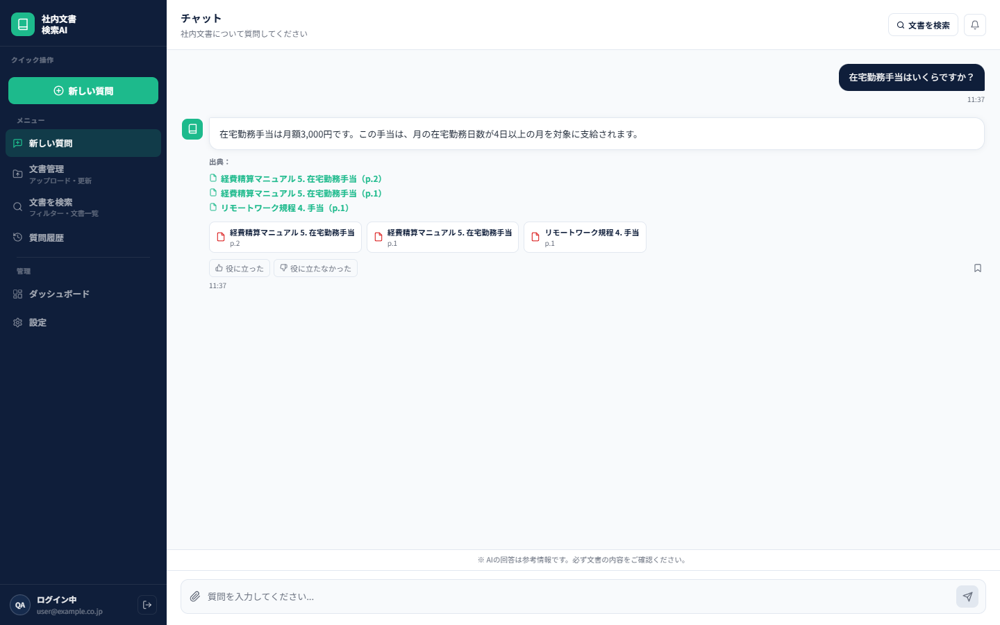

### 必ず出典を確認してください

**出典をクリックすると、AIが根拠にした文書の実際の文章が表示されます。**

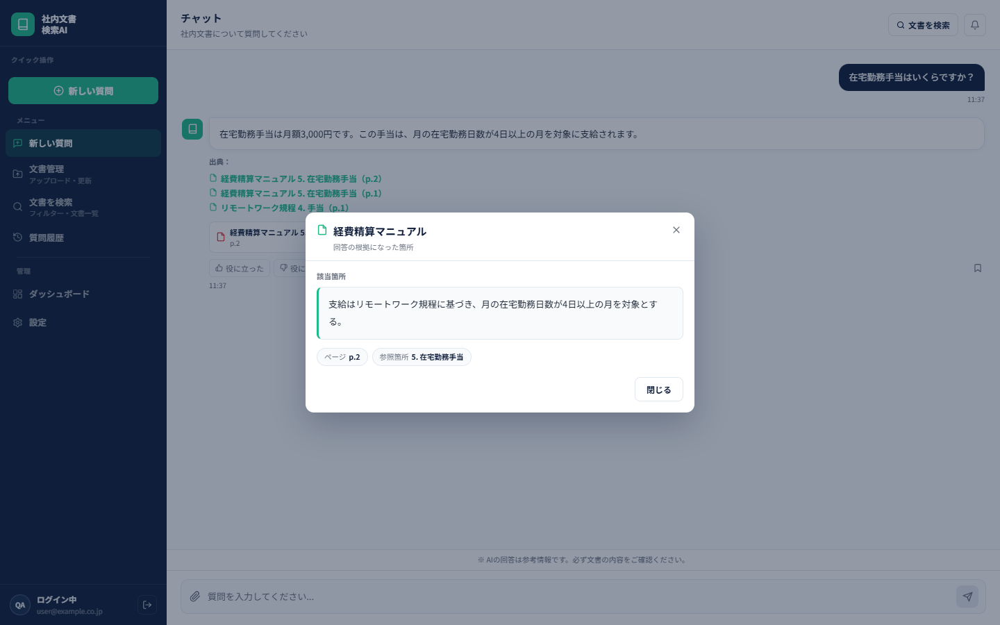

「該当箇所」に表示されるのが、AIが根拠にした文書の原文です。
ページ番号と参照箇所（章・条）も併せて表示されます。

重要な判断（金額・日数・申請期限など）に使う場合は、
回答本文だけで判断せず、必ず出典の原文まで確認してください。

### 「該当する情報を社内文書から確認できませんでした。」と表示された場合

これは**正常な動作**です。エラーではありません。

AIは、登録されている文書に根拠が見つからないとき、推測で答えずにこの文言を返します。
「知らないことを答えてしまう」ことを防ぐための仕組みです。

この表示が出たときは、次のいずれかです。

| 考えられる原因 | 対処 |
|---|---|
| その内容の文書がまだ登録されていない | 該当する文書を登録する |
| 文書はあるが、質問の言い回しが文書の表現と離れている | 文書で使われている用語で聞き直す（例：「在宅手当」→「在宅勤務手当」） |
| 実際に社内文書に定めがない | 担当部署へ確認する |

---

## 7. 回答がおかしいときの切り分け手順

> この章で分かること：**「回答が間違っている」と言われたとき**に、上から順に確認する手順

「回答が間違っている」と言われたときは、上から順に確認してください。
**多くの場合、AIの性能ではなく文書側に原因があります。**

```
STEP 1 → STEP 2 → STEP 3 → STEP 4 → STEP 5
```

### STEP 1：そもそも文書が登録されているか

1. 「文書検索」画面を開きます
2. 文書名やキーワードで検索します
3. 目的の文書が一覧に出てくるか確認します

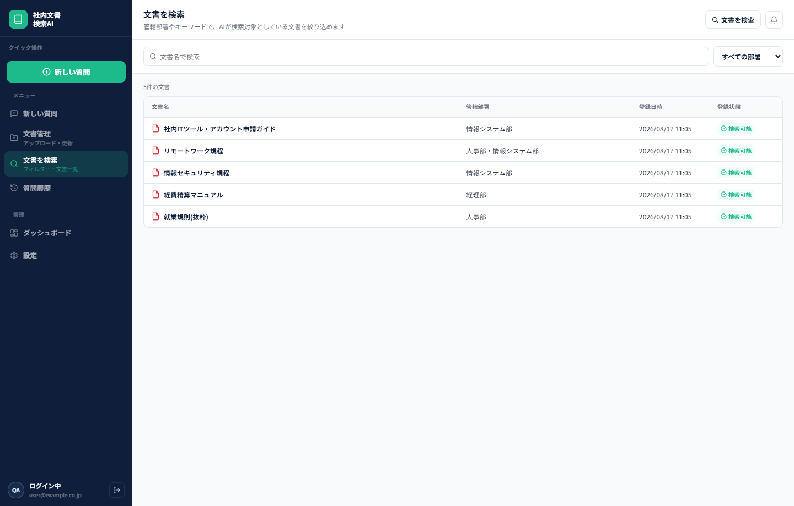

- **出てこない** → 文書が未登録です。[3章](#3-新しいpdfを登録する)の手順で登録してください
- **出てくる** → STEP 2へ

### STEP 2：文書の登録状態が「検索可能」になっているか

一覧の「登録状態」列を確認します。

| 状態 | 意味 | 対処 |
|---|---|---|
| 検索可能 | 正常。検索対象になっています | STEP 3へ |
| 処理中 | まだ検索用データを作成中です | 数分待ってから再確認してください |
| **エラー** | 取り込みに失敗しています | その文書を削除し、もう一度アップロードしてください。繰り返し失敗する場合はPDFに問題がある可能性があります（スキャンPDF等） |

### STEP 3：登録されている版が最新か

一覧の「登録日時」と、手元の最新版の改訂日を比べます。

- **古い版が登録されている** → [4章](#4-文書を更新するときの考え方)の手順で入れ替えてください
- **同じ文書が2件ある** → 古い方を削除してください（AIが古い方を根拠に答えることがあります）

### STEP 4：出典を開いて、文書に何と書かれているか確認する

回答の出典リンクを押し、実際の文章を読みます。

| 確認結果 | 判断 |
|---|---|
| 文書の記載どおりに回答している | AIは正しく動作しています。**文書側の記載が古い・分かりにくい**可能性があります |
| 文書には正しく書いてあるのに、回答が違う | STEP 5へ |
| 出典が表示されていない（該当なし応答） | [6章](#6-aiの回答を確認する)の該当なしの項を参照してください |

#### 出典の参照箇所が見つからない場合

出典に表示された章・条（例：「第2章 休日・休暇」）を文書内で探しても見つからないときは、
**文書が再アップロードされた可能性があります。**

ブラウザを再読み込みしてから、同じ質問をもう一度送信してください。
表示中の回答は再アップロード前の古い内容を指しているため、新しい回答では正しい参照箇所が表示されます。

再読み込みしても改善しない場合は、STEP 5へ進んでください。

### STEP 5：質問の言い回しを変えて再確認する

同じことを、文書内で使われている言葉で聞き直します。

- 例：「テレワークの手当は？」→「在宅勤務手当はいくらですか？」
- 例：「経費はいつまで？」→「経費精算の申請期限を教えてください」

言い回しを変えて正しく答えられる場合、**文書内の見出しや用語と、社員が使う言葉が離れている**ことが原因です。
この場合は、次のいずれかで改善します。

- 文書側に、社員が使う言葉（通称）を併記する
- 開発担当者へ報告し、検索設定の調整を検討する

### STEP 5でも解決しない場合

開発担当者へ、次の情報を添えてご連絡ください。

- 入力した質問文（そのままコピーしてください）
- 表示された回答
- 表示された出典（文書名・ページ）
- 期待していた回答と、その根拠となる文書名・ページ

---

## 8. よくあるエラーと対処

> この章で分かること：画面に出るメッセージ別の**対処法**

| 表示 | 意味 | 対処 |
|---|---|---|
| 回答の取得に失敗しました | 一時的な通信エラー | もう一度質問してください。繰り返す場合は開発担当者へ連絡してください |
| 現在アクセスが集中しています / 利用制限に達しました | AIサービスの利用回数制限 | しばらく待ってから再度お試しください（下記の注意を参照） |
| PDFからテキストを抽出できませんでした | スキャン画像のみのPDF | 文字が選択できるPDFを用意してください |
| ファイルサイズが上限を超えています | 50MB超のPDF | PDFを分割するか、開発担当者へ相談してください |
| PDF以外のファイルは登録できません | Word等を選んでいる | PDF形式に変換してから登録してください |
| 対象の文書が見つかりませんでした | 既に削除されている | 画面を再読み込みしてください |
| ログインが必要です | セッションの期限切れ | もう一度ログインしてください |

> **AIサービスの利用回数制限について**
> 現在の設定（Gemini APIの無料枠）では、**1日約20回・1分間に約5回**が上限です。
> 短時間に連続して質問すると、この制限に達して一時的に回答できなくなります。
> **これはAIの精度が落ちたのではなく、回数の上限です。**
> 本格運用の際は、有料プランへの切り替えが必要です（開発担当者へご相談ください）。

---

## 9. APIキー・環境変数の管理方針

> この章で分かること：**鍵（キー）の取り扱いルール**と、漏れたときの対応

このシステムは、外部サービスへ接続するための「鍵」を使っています。
**鍵の管理は、社外への情報漏洩を防ぐうえで最も重要な部分です。**

### 鍵の種類と取り扱い

| 鍵の名前 | 何の鍵か | 漏れたときに起きること | 取り扱い |
|---|---|---|---|
| `SUPABASE_SERVICE_ROLE_KEY` | データベースの管理者キー | **社内文書の全データを外部から読み書きされます** | **絶対に外部へ出さない** |
| `GEMINI_API_KEY` | AIサービスの利用キー | 第三者に無断で使われ、料金が発生します | **絶対に外部へ出さない** |
| `ALLOWED_EMAIL_DOMAIN` | 社内メールドメインの設定 | （秘密情報ではありません） | 変更時は下記の手順が必要です |
| `NEXT_PUBLIC_SUPABASE_URL` | データベースの接続先 | （公開してよい値です） | — |
| `NEXT_PUBLIC_SUPABASE_ANON_KEY` | 一般利用者用の接続キー | （公開してよい値です。アクセス制限が別途かかっています） | — |

### 守っていただきたいルール

1. **鍵をメール・チャット・スプレッドシートに貼り付けない**
   一度送信すると、送信先の履歴に残り続けます
2. **鍵をソースコードに直接書かない**
   現在の実装では、すべて環境変数で管理しています
3. **`.env.local` ファイルをGitへ登録しない**
   設定ファイルで除外済みですが、コピーを作る際もご注意ください
4. **鍵の設定・変更は決められた担当者のみが行う**
   Vercel（公開基盤）の管理画面で設定します
5. **担当者の異動・退職時は鍵を作り直す**
   Supabase・Google AI Studioの管理画面から再発行できます

### 鍵が漏れた可能性があるときの対応

1. すぐに開発担当者へ連絡してください
2. Supabase管理画面で `service_role` キーを再発行します
3. Google AI Studioで Gemini APIキーを再発行します
4. Vercelの環境変数を新しい値へ更新し、再デプロイします
5. Supabaseのログで、想定外のアクセスがなかったかを確認します

### 社内メールドメインを変更する場合

会社のメールドメインが変わる場合は、**2か所の更新が必要です。**

1. Vercelの環境変数 `ALLOWED_EMAIL_DOMAIN` を新しいドメインへ変更する
2. 開発担当者が `npm run sync:allowed-domain` を実行し、データベース側へ反映する

> **2の実行を忘れると、「ログインはできるのに文書が1件も表示されない」状態になります。**
> データベース側にも同じドメイン制限をかけているためです（社外からの直接アクセスを防ぐ仕組みです）。
> この作業は必ず開発担当者へ依頼してください。

---

## 10. 日常運用のチェックリスト

> この章で分かること：**作業のたび・月次・担当交代時**に確認すること

### 文書を登録・更新したとき

- [ ] 登録状態が「検索可能」になっている
- [ ] 改訂版は一覧の「更新」ボタンから登録した
- [ ] 同じ文書が2件登録されていない
- [ ] 実際にその文書に関する質問をして、正しく回答されることを確認した

### 月に一度

- [ ] 文書一覧と、実際の最新版を突き合わせた
- [ ] 登録状態が「エラー」の文書が残っていないか確認した
- [ ] 「該当なし」と返されることが多い質問がないか、利用者へヒアリングした

### 担当者が変わるとき

- [ ] この手順書を引き継いだ
- [ ] Vercel・Supabase・Google AI Studioの管理権限を引き継いだ
- [ ] 前任者のアクセス権を削除した
- [ ] 各種キーを再発行した

---

## 11. 使い方ガイド（社員向け）

> この章で分かること：**社員へ配布・周知する内容**（質問の仕方とコツ）

社員の方へ配布・周知いただく想定の簡易ガイドです。

### チャットで質問する

1. ブラウザで（システムURL）を開く
2. 社内メールアドレスでログインする
3. チャット画面で質問を入力して送信する
4. AI回答と出典（文書名・ページ）が表示される
5. 出典をクリックすると該当箇所のテキストを確認できる

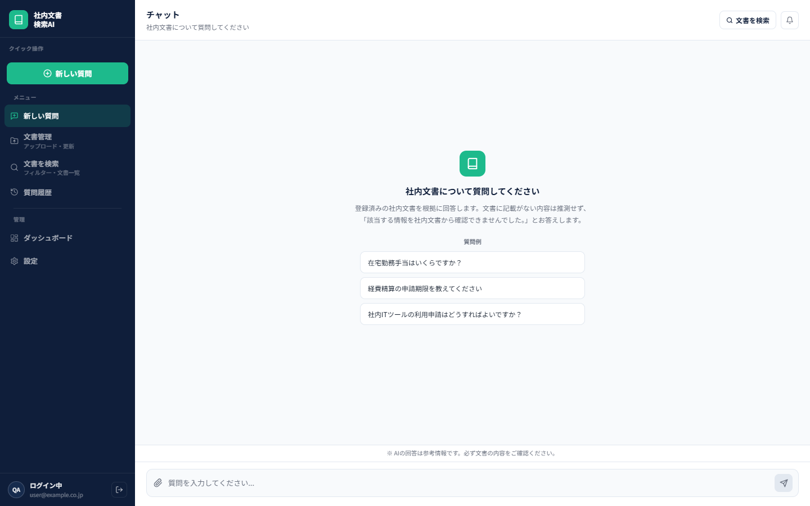

質問例が表示されているので、押すだけでも試せます。

スマートフォンからも同じように利用できます（画面下のボトムナビで移動します）。

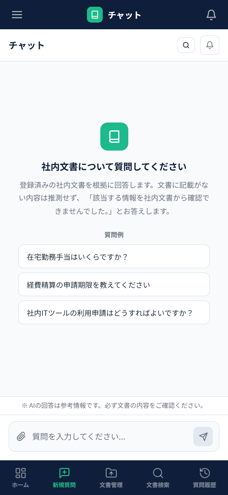

> システムURLはVercelへのデプロイ後に確定します。周知の際はこの箇所を実際のURLへ置き換えてください。

### 質問のコツ

- **具体的に質問する**
  - 良い例：「在宅勤務手当はいくらですか？」
  - 悪い例：「手当について」

- **文書にない情報は回答されない**
  - 「該当する情報を社内文書から確認できませんでした。」と表示された場合は、対象文書に記載がないことを意味します
  - これは不具合ではなく、推測で答えないための正常な動作です

- **複数の文書にまたがる情報も検索できる**
  - 例：「在宅勤務手当」は経費精算マニュアルとリモートワーク規程の両方から回答されます

---

## 12. APIキー設定ガイド（管理者向け）

> この章で分かること：**APIキーの取得方法**と、本番環境への設定手順

鍵の取り扱いに関する考え方は[9章](#9-apiキー環境変数の管理方針)に、
ここでは実際の取得・設定手順を記載します。

### Gemini APIキーの取得

1. Google AI Studio（https://aistudio.google.com/）にアクセス
2. Googleアカウントでログイン
3. 「Get API key」をクリック
4. APIキーを取得する

### 本番環境でのAPIキー設定（Vercel）

APIキーは必ずVercelの環境変数で管理してください。
コードやGitHubリポジトリには絶対に含めないでください。

**準備すること**

| # | 準備 |
|---|---|
| 1 | Vercelの管理画面へログインできる権限 |
| 2 | Supabaseの管理画面から取得した3つの値（下表参照） |
| 3 | Google AI Studioで取得したAPIキー |

**手順**

1. Vercelダッシュボードを開く
2. プロジェクトを選択
3. Settings → Environment Variables
4. 以下のキーを設定する

| 変数名 | 説明 |
|---|---|
| `NEXT_PUBLIC_SUPABASE_URL` | SupabaseプロジェクトURL |
| `NEXT_PUBLIC_SUPABASE_ANON_KEY` | Supabase匿名キー |
| `SUPABASE_SERVICE_ROLE_KEY` | Supabaseサービスロールキー（秘密） |
| `GEMINI_API_KEY` | Gemini APIキー（秘密） |
| `ALLOWED_EMAIL_DOMAIN` | 許可するメールドメイン（例：company.co.jp） |

> **注意：** `SUPABASE_SERVICE_ROLE_KEY` と `GEMINI_API_KEY` は絶対に外部へ公開しないでください。
> `SUPABASE_SERVICE_ROLE_KEY` が漏れると、社内文書の全データを外部から読み書きされます。

**確認すること**

| # | 確認 | 正常な状態 |
|---|---|---|
| 1 | 5つの変数すべてを設定したか | 設定漏れがあると起動時にエラーになります |
| 2 | `SUPABASE_SERVICE_ROLE_KEY` と `GEMINI_API_KEY` の先頭に `NEXT_PUBLIC_` が付いていないか | **付いているとブラウザへ露出します。絶対に付けないでください** |
| 3 | 再デプロイしたか | 環境変数は再デプロイしないと反映されません |
| 4 | ログインできるか | できない場合は `ALLOWED_EMAIL_DOMAIN` の値を確認 |

> **`ALLOWED_EMAIL_DOMAIN` を設定・変更したら、開発担当者が `npm run sync:allowed-domain` を実行する必要があります。**
> データベース側にも同じドメイン制限をかけているためです（社外からの直接アクセスを防ぐ仕組み）。
> 実行を忘れると「ログインはできるのに文書が1件も表示されない」状態になります。詳細は[9章](#9-apiキー環境変数の管理方針)を参照してください。

### BYOKデモモード（`/demo`）のAPIキー

デモモードではユーザーが自分のGemini APIキーを入力します。
キーはブラウザのsessionStorageに保存され、タブを閉じると自動的に削除されます。
サーバーには送信されません。

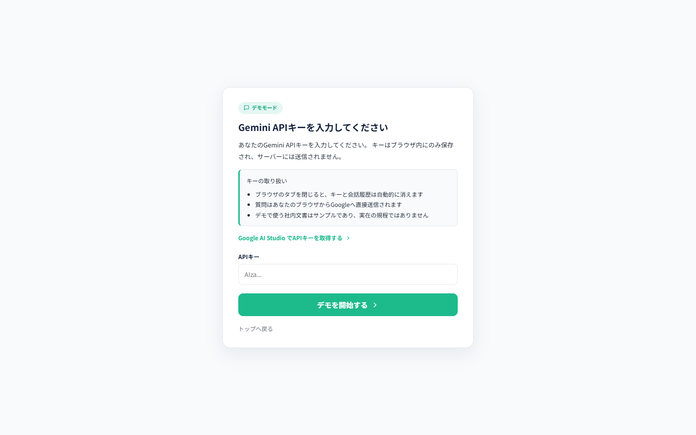

> デモモードは営業・確認用です。ベクトル検索を行わずサンプル5文書の全文をAIへ渡す簡易版のため、
> **精度検証の数値（回答精度100%）はデモには当てはまりません。**

---

## 13. トラブルシューティング

> この章で分かること：**症状から原因を引く**ための一覧

### 症状から探す

| こんなとき | 参照先 |
|---|---|
| ログインできない・確認メールが届かない | [ログインできない](#ログインできない)（原因7つ） |
| AIの回答が間違っている・古い | [AI回答がおかしい](#ai回答がおかしい)（原因4つ） |
| PDFが登録できない・エラーになる | [PDFアップロードできない](#pdfアップロードできない)（原因6つ） |
| 「利用制限に達しました」と出る | [APIの利用制限エラー](#apiの利用制限エラー) |
| 文書を更新したのに反映されない | [4章 文書を更新するときの考え方](#4-文書を更新するときの考え方) |
| 登録状態が「処理中」から変わらない | [14-6 再生成がうまくいかないとき](#14-6-再生成がうまくいかないとき) |
| 上記で解決しない | [開発者・管理者向け問い合わせ先](#開発者管理者向け問い合わせ先) |

**「回答が間違っている」と相談された場合**は、原因の多くが文書側にあります。
[7章の切り分け手順](#7-回答がおかしいときの切り分け手順)を上から順に確認してください。

### ログインできない

| 症状 | 原因 | 対処 |
|---|---|---|
| 「社内メールアドレスで登録してください。」と表示 | 許可されていないメールドメイン | 社内メールアドレス（@company.co.jp）で登録する |
| 「メールアドレスまたはパスワードが正しくありません。」と表示 | 入力ミス | パスワードを確認・再入力する |
| 「メールアドレスの確認が完了していません。」と表示 | 確認メールのリンクを開いていない | 届いている確認メールのリンクを開いてからログインする |
| 確認メールが届かない | 迷惑メールフォルダに振り分けられている | 迷惑メールフォルダを確認する |
| 確認メールのリンクが期限切れ | リンクの有効期限が過ぎた | もう一度アカウント登録から実施する |
| 「システムの設定が未完了です。」と表示 | `ALLOWED_EMAIL_DOMAIN` の設定漏れ | 利用者側では解決できません。開発担当者へ連絡する |
| 「ログインの試行回数が上限に達しました。」と表示 | 短時間に何度も失敗した | しばらく待ってからもう一度試す |

### AI回答がおかしい

| 症状 | 原因 | 対処 |
|---|---|---|
| 「該当する情報を社内文書から確認できませんでした。」と表示 | 対象文書に記載がない | 文書管理で該当文書が登録済みか確認する |
| 回答が古い内容 | 文書が更新されているが登録し直していない | 文書管理の**「更新」**から最新PDFを登録する（[4章](#4-文書を更新するときの考え方)） |
| 同じ文書が一覧に2件ある | 「更新」を使わずアップロードし、PDFのタイトルが変わっていた | 古い方を「削除」する。以降は「更新」ボタンを使う |
| 出典が表示されない | 文書外の質問への回答 | 出典なしは文書に根拠がない場合の正常な動作 |
| 出典の章・条が文書内に見つからない | 文書が再アップロードされた直後 | ブラウザを再読み込みして同じ質問を送り直す |

### PDFアップロードできない

| 症状 | 原因 | 対処 |
|---|---|---|
| 「PDF以外のファイルはアップロードできません」と表示 | 対応形式以外のファイル | PDFファイルを選択する |
| 「ファイルサイズが50MBを超えています」と表示 | ファイルが大きすぎる | PDFを分割して再アップロードする |
| 4.5MB程度でもアップロードできない | 公開環境（Vercel）側のリクエスト上限 | 開発担当者へ相談する（[3章](#3-新しいpdfを登録する)の注意を参照） |
| ステータスが「エラー」になる | PDFが読み取れない形式 | スキャン画像のみのPDFは非対応。テキスト付きPDFを使用する |
| 「PDFを読み取れませんでした」と表示 | パスワード付き・破損したPDF | パスワードを解除するか、PDFを作り直す |
| アップロードしたのに検索できない | 処理中 | ステータスが「検索可能」になるまで待つ |

### APIの利用制限エラー

| 症状 | 原因 | 対処 |
|---|---|---|
| 「APIの利用制限に達しました。1分ほど待ってから再度お試しください。」と表示 | Gemini無料枠の上限（1日20回・毎分5回） | 1分待ってから再質問する。または翌日に試す |

> 本格運用では無料枠では足りません。有料プランへの切り替えを開発担当者へご相談ください。

### 開発者・管理者向け問い合わせ先

上記で解決しない場合は、以下の情報を添えて開発担当者へ連絡してください。

- 発生した操作の手順（いつ・どの画面で・何をしたか）
- エラーメッセージの全文（画面のスクリーンショットがあると確実です）
- 発生日時
- 使用ブラウザ・OS
- 入力した質問文（AI回答に関する場合はそのままコピーしてください）

---

## 14. 検索用データ（Embedding）の再生成とコスト

> この章で分かること：**いつ費用が発生するか**と、抑えるための運用

「検索用データ」は、AIが文書を検索できるようにするための変換結果です。
技術的には **Embedding（エンベディング）** と呼びます。
**この変換だけが、文書の追加・更新のたびに外部AIサービスの利用料が発生する箇所**です。

### 14-1. どういうものか

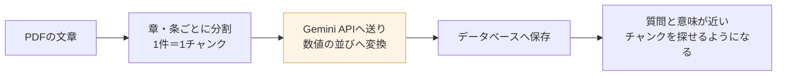

**料金がかかるのはオレンジの箇所です。** 分割したチャンクの数だけAPIを呼びます。

### 14-2. 再生成が必要になるタイミング

| タイミング | 再生成の範囲 | 担当 |
|---|---|---|
| **新しいPDFを追加した** | その文書のみ | 運用担当者（自動で実行されます） |
| **文書を「更新」した** | その文書のみ | 運用担当者（自動で実行されます） |
| 文書を削除した | 不要（データも一緒に消えます） | — |
| **AIモデルを変更した** | **全文書** | 開発担当者 |
| **分割方法（チャンク設定）を変更した** | **全文書** | 開発担当者 |

**上2つは画面から操作するだけで自動的に実行されます。** 特別な作業は不要です。

**下2つは全文書の作り直しになります。**
文書が増えているほど時間と費用がかかるため、**構成の変更は文書を大量に登録する前に済ませてください。**
判断が必要な場合は開発担当者へご相談ください。

### 14-3. 処理にかかる時間の目安

| 文書量 | 目安 |
|---|---|
| 1文書（数ページ） | 数十秒 |
| 現在の登録分（5文書・34チャンク） | 1〜2分程度 |

処理中も、他の文書への質問は通常どおり行えます。
更新中の文書だけが一時的に検索対象から外れます。

### 14-4. 費用の考え方

費用は **「変換する文字数 × 単価」** で決まります。回数ではなく分量で決まる点に注意してください。

**現在の登録分の実測値**

| 項目 | 実測値 |
|---|---|
| 登録文書数 | 5文書 |
| チャンク数 | 34件 |
| 変換対象の総文字数 | 約3,300文字 |
| 1チャンクあたりの平均 | 約97文字 |

> **これは検証用のサンプル文書での数値です。**
> 実際の社内規程・マニュアルは1文書あたりの分量がこれより大きいため、
> **この数値をそのまま200文書へ掛け算しないでください。**
> 正確な試算には、実際の文書を数本取り込んで1文書あたりの文字数を測る必要があります。

**費用が増える要因**

| 要因 | 影響 |
|---|---|
| 文書を追加する | 追加した分だけ増える（1回のみ） |
| 文書を更新する | その文書の分だけ再度発生する（更新のたび） |
| 全文書の作り直し | **登録済み文書すべての分が一度に発生する** |
| 質問する | Embeddingは質問文1件分のみ。回答生成の費用は別途発生する |

**単価は契約プランによって変わります。**
現在は無料枠で動作していますが、本格運用では有料プランへの切り替えが必要です。
最新の単価はGoogle AI Studioの料金ページでご確認ください
（このドキュメントに単価を記載すると、改定時に古い情報が残るため記載していません）。

### 14-5. 費用を抑えるための運用

| 方法 | 効果 |
|---|---|
| 誤字修正など軽微な変更では更新しない | 更新のたびに全チャンクを作り直すため |
| 改訂をまとめて反映する | 同じ文書を何度も更新しない |
| 不要な文書は削除する | 全文書の作り直し時に対象から外れる |
| 構成変更は文書を増やす前に済ませる | 作り直しの対象が少ないうちに実施する |

> **現時点では「変更があった部分だけ作り直す」機能はありません。**
> 1文字直しただけでも、その文書全体を作り直します。
> 差分更新はPhase 2で対応予定です（[phase2-proposal.md](phase2-proposal.md)）。

### 14-6. 再生成がうまくいかないとき

| 症状 | 原因 | 対処 |
|---|---|---|
| 登録状態が「処理中」のまま数分以上変わらない | 処理が止まっている可能性 | 画面を再読み込みする。それでも変わらなければ削除して登録し直す |
| 登録状態が「エラー」になる | PDFが読めない、またはAPI側の問題 | 削除して登録し直す。繰り返す場合はPDFに問題がある可能性（スキャンPDF等） |
| 登録直後に質問しても「該当なし」 | 検索用データの作成が未完了 | 「検索可能」になってから質問する |
| 「APIの利用制限に達しました」と出て登録できない | 無料枠の上限 | 1分ほど待って再実行する。頻発する場合は有料プランへの切り替えを検討 |
