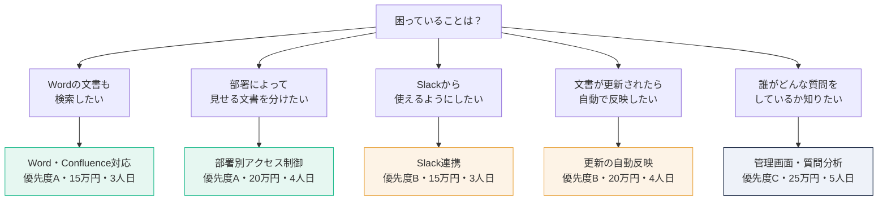
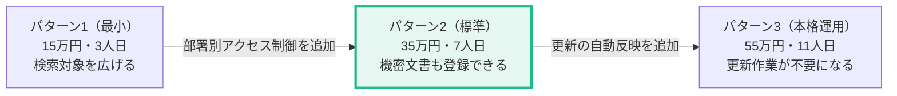
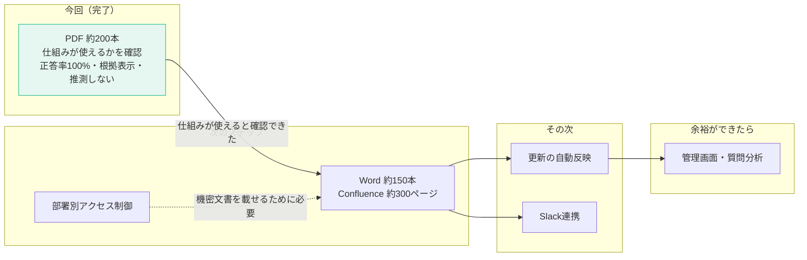

# Phase 2 ご提案

社内文書検索AI　次のステップのご提案

作成日：2026年8月20日

---

## 3行の要約

1. **今回できたこと** — 社内のPDFを登録すると、社員がチャットで質問するだけで答えが返り、根拠となった文書名とページも一緒に表示されます。書かれていないことは推測せず「確認できませんでした」と答えます。
2. **次にやること** — 検索できる文書をWord・Confluenceへ広げ、部署ごとに見せる範囲を分けられるようにします。
3. **費用感** — おすすめは35万円（7人日）から。全部で95万円（19人日）です。

---

## このドキュメントで分かること

| # | 章 | 分かること |
|---|---|---|
| 1 | [今回のシステムでできるようになったこと](#1-今回のシステムでできるようになったこと) | 何がどこまでできるか |
| 2 | [次に追加できる5つの機能](#2-次に追加できる5つの機能) | 機能ごとの困りごと・効果・費用 |
| 3 | [何から発注すればよいか](#3-何から発注すればよいか) | 困りごとから選ぶ／おすすめの3パターン |
| 4 | [なぜ今回はPDFだけだったのか](#4-なぜ今回はpdfだけだったのか) | 対象を絞った理由 |
| 5 | [なぜ部署別の権限管理を今回入れなかったのか](#5-なぜ部署別の権限管理を今回入れなかったのか) | セキュリティを後回しにしたわけではない理由 |
| 6 | [本番導入前に確認が必要なこと](#6-本番導入前に確認が必要なこと) | 判断が必要な項目 |
| 7 | [ご相談したいこと](#7-ご相談したいこと) | 次に決めていただきたい5点 |

> **専門知識は不要な内容にしています。** 技術的な詳細が必要な場合は、開発担当者向けの資料を別途ご用意しています。

---

## 1. 今回のシステムでできるようになったこと

### 何ができるか

| できること | 内容 |
|---|---|
| 質問するだけで答えが返る | 社員が「在宅勤務手当はいくらですか？」と入力すると、社内文書を根拠に回答します |
| 根拠が必ず示される | 回答には文書名・ページ番号・該当箇所が付きます。クリックすると原文を確認できます |
| **書いていないことは答えない** | 根拠が見つからない場合は「該当する情報を社内文書から確認できませんでした。」と返します |
| 社内の人しか使えない | 社内メールアドレス以外ではログインも閲覧もできません |
| 担当者が自分で文書を追加できる | 管理画面からPDFを登録・更新・削除できます。開発者への依頼は不要です |

### 検証結果

あらかじめ用意した評価データ12問を使い、実際の運用と同じ経路で確認しました。

| 確認したこと | 結果 | 判定 |
|---|---|---|
| 正しい文書を見つけられるか | 記載あり10問すべてで正解の文書を取得 | **100%** |
| 正しく回答できるか | 10問すべてで正しく回答 | **100%**（目標80%を達成） |
| 根拠を示せるか | 12問すべてで文書名・ページを表示 | **100%** |
| **推測で答えてしまわないか** | **12問すべてで推測なし** | **0件** |

検証条件：評価データ12問 / 対象文書5件 / 実際の運用と同じ操作

> **【重要】この数値は12問・5文書での実測値です。**
> すべての社内文書・すべての質問に対する精度を保証するものではありません。
> 文書量が増えた段階で、改めて確認することを推奨します。

詳細：[検証レポート](validation/rag-accuracy-report.md)

### 検証を通じて分かった4つのこと

**1. 「AIが推測で答えない」ことは実現できています**

文書に記載のない2問では、いずれも推測せず「確認できませんでした」と回答しました。
社員が誤った情報で判断してしまうことを避けたい、というご要望に直接対応しています。

**2. 答えの質を左右するのは、AIの性能よりも「文書の作り」です**

唯一答えられなかった1問は、AIの性能不足ではありませんでした。
正解の一文は見つかっていましたが、**文書を区切る位置が申請手順の途中に入っていた**ため、
AIがその一文だけでは意味を判断できず、根拠として採用しませんでした。

**推測で答えなかったという意味では、正しい動作です。**
文書量を増やす際は、文書側の見出し構造を整えることが精度に効きます。

**3. 「書いていないことは答えない」判断は、実質1段階で成立しています**

文書に記載のない質問でも、検索の段階では候補が残ることがありました。
実際に止めているのは、その後の回答を作る段階です。
文書が増えると無関係な文書が候補に入る確率も上がるため、
**文書量を増やしたうえでの再確認が必要**です。

**4. 運用上いちばん大きなリスクは「古い文書が残ること」です**

今回のシステムには、文書の更新を自動で反映する仕組みがありません。
改訂版を登録しても古い版を残したままにすると、AIは古い内容で答えます。

技術的な不具合ではなく運用の問題ですが、
**月5〜10本の更新がある御社では、手作業のままだと必ず取りこぼしが発生します。**
これが、次章の「更新の自動反映」を重視している理由です。

---

## 2. 次に追加できる5つの機能

| # | 機能 | 優先度 | 費用 | 工数 |
|---|---|---|---|---|
| 1 | Word・Confluence対応 | **A** | 15万円 | 3人日 |
| 2 | 部署別アクセス制御 | **A** | 20万円 | 4人日 |
| 3 | Slack連携 | **B** | 15万円 | 3人日 |
| 4 | 更新の自動反映 | **B** | 20万円 | 4人日 |
| 5 | 管理画面・質問分析 | **C** | 25万円 | 5人日 |
| | **合計** | | **95万円** | **19人日** |

### 優先度の意味

| 優先度 | 位置づけ |
|---|---|
| **A** | まず必要。これが無いままだと、載せられる文書が限られたままになる |
| **B** | 次に検討。運用の手間を減らし、使われる範囲を広げる |
| **C** | 余裕ができたら。使われ方を分析して改善につなげる |

### 工数の比較

バーの長さが工数（人日）に対応します。

```mermaid
gantt
    title 機能別の想定工数（人日）
    dateFormat X
    axisFormat %s
    section 優先度A
    Word・Confluence対応　15万円   :a1, 0, 3
    部署別アクセス制御　20万円     :a2, 0, 4
    section 優先度B
    Slack連携　15万円              :b1, 0, 3
    更新の自動反映　20万円         :b2, 0, 4
    section 優先度C
    管理画面・質問分析　25万円     :c1, 0, 5
```

---

### 1. Word・Confluence対応（優先度A・15万円・3人日）

**今、何が困るか**

- 検索できるのはPDFだけです。Word約150本、Confluence約300ページは対象外です
- 社員が探しても見つからず、「結局、先輩に聞く」が残ります
- 「このシステムでは出てこない」という経験が続くと、使われなくなります

**この機能を入れると何が変わるか**

- 検索対象が**約200本から約650単位へ、およそ3倍**になります
- 登録の操作はPDFと同じです。担当者が新しい手順を覚える必要はありません
- Confluenceは更新されたページを取り込めるようにします

**費用・工数**：15万円・3人日

**優先度Aの理由**：対象文書が3倍になり、「探したのに無い」が最も減るためです。

---

### 2. 部署別アクセス制御（優先度A・20万円・4人日）

**今、何が困るか**

- **ログインした社員は、登録されている全文書を検索できます**
- そのため、人事評価・給与・役員会議の資料など、限定公開すべき文書は登録できません
- 結果として、載せられる文書の範囲が制限されます

**この機能を入れると何が変わるか**

- 文書ごとに「全社公開」「特定部署のみ」を設定できます
- 所属部署に応じて、検索結果に出る文書が変わります
- 異動・退職時に権限を見直す手順も整備します
- **機密性の高い文書も安心して登録できるようになります**

**費用・工数**：20万円・4人日

**優先度Aの理由**：これが無いと、登録できる文書の範囲が広がらないためです。

> **【重要】事前に決めていただく必要があるもの**
> 部署の一覧／社員と部署の対応をどう管理するか／兼務者の扱い／異動・退職時に誰がいつ権限を更新するか。
> これらが決まらないまま導入すると、
> **「異動したのに前の部署の文書が見え続ける」**という最も危険な状態になります。

---

### 3. Slack連携（優先度B・15万円・3人日）

**今、何が困るか**

- 質問するにはブラウザでシステムを開く必要があります
- 「わざわざ開くくらいなら人に聞く」となり、口頭での問い合わせが残ります

**この機能を入れると何が変わるか**

- Slackから直接質問でき、根拠となる文書名も一緒に返ります
- 普段使っているツールの中で完結するため、**利用のハードルが大きく下がります**
- 口頭での問い合わせ削減に、最も直接的に効きます

**費用・工数**：15万円・3人日

**優先度Bの理由**：効果は大きいものの、**先に対象文書を揃えないと逆効果**になるためです。
文書が少ない状態で利用者を増やすと、「聞いても答えられない」経験が広まり、定着しなくなります。

---

### 4. 更新の自動反映（優先度B・20万円・4人日）

**今、何が困るか**

- 規程を改訂したら、担当者が**手作業で**登録し直す必要があります
- 古い版を消し忘れると、**AIが古い内容で回答します**
- 月5〜10本の更新がある御社では、取りこぼしが起きます
- 1文字直しただけでも、その文書全体を作り直します

**この機能を入れると何が変わるか**

- 共有フォルダやConfluenceの更新を検知し、自動で反映します
- 古い版は自動的に置き換わるため、消し忘れが起きません
- 変更があった部分だけを作り直すため、**AIサービスの利用料も下がります**
- **担当者の作業がほぼゼロになります**

**費用・工数**：20万円・4人日

**優先度Bの理由**：運用の手間とリスクを最も減らせますが、
まず対象文書を増やしてからの方が効果を実感しやすいためです。

---

### 5. 管理画面・質問分析（優先度C・25万円・5人日）

**今、何が困るか**

- どんな質問が多いのか、何に答えられていないのかが分かりません
- **どの文書を追加すべきか**が、担当者の勘に頼っています
- 文書の一括登録や、取り込みに失敗した文書の再実行ができません

**この機能を入れると何が変わるか**

- よく聞かれる質問、答えられなかった質問を集計できます
- 「確認できませんでした」が多い分野＝**文書が不足している分野**が分かります
- 文書の一括登録・削除、失敗した取り込みの再実行ができます
- 利用者の一覧・権限の管理ができます

**費用・工数**：25万円・5人日

**優先度Cの理由**：文書が揃ってから効果が出るためです。

> **【注意】** 質問内容は、誰が何を調べたかが分かるデータです。
> 集計方法・閲覧できる人・保存期間を、導入前に社内で取り決める必要があります。

---

### 別途お見積りとなる項目

| 機能 | 内容 |
|---|---|
| スキャンした紙文書への対応 | 紙をスキャンした画像だけのPDFから文字を読み取ります。読み取り精度は100%ではなく、誤読がそのまま回答の根拠になるため、対象文書を限定しての導入を推奨します |
| セキュリティ認証（SOC2等）への対応検討 | 技術的な対策だけでなく、組織体制・運用ルール・外部監査を含みます。取引先から要求されている項目の確認から着手します |

---

## 3. 何から発注すればよいか

### 困りごとから選ぶ

| 困っていること | おすすめの機能 | 補足 |
|---|---|---|
| Wordの文書も検索したい | **Word・Confluence対応**（優先度A・15万円・3人日） | — |
| 部署によって見せる文書を分けたい | **部署別アクセス制御**（優先度A・20万円・4人日） | **機密文書を登録する前に導入を推奨** |
| Slackから使えるようにしたい | **Slack連携**（優先度B・15万円・3人日） | **先に文書を揃えてから** |
| 文書が更新されたら自動で反映したい | **更新の自動反映**（優先度B・20万円・4人日） | — |
| 誰がどんな質問をしているか知りたい | **管理画面・質問分析**（優先度C・25万円・5人日） | 集計方法・保存期間を事前に取り決める |

### おすすめの発注パターン

「何から始めればよいか分からない」場合は、この3つからお選びください。

| パターン | 含む機能 | 費用 | 工数 | 何が変わるか |
|---|---|---|---|---|
| **1（最小）** | Word・Confluence対応 | **15万円** | **3人日** | 検索できる文書が約3倍になる |
| **2（標準）** | パターン1 ＋ 部署別アクセス制御 | **35万円** | **7人日** | **機密文書も安心して登録できる** |
| **3（本格運用）** | パターン2 ＋ 更新の自動反映 | **55万円** | **11人日** | **更新作業が不要になる** |

**【推奨】パターン2（35万円・7人日）からの開始をおすすめします。**

| # | 理由 |
|---|---|
| 1 | パターン1だけだと、検索できる文書は増えても**機密性の高い文書は登録できないまま**です |
| 2 | 部署別アクセス制御は、文書を大量に登録した**後**に入れると、既存文書すべての公開範囲を設定し直す作業が発生します |

その後、運用してみて手作業の負担が大きいと感じられた段階でパターン3へ進む形が、
無駄のない進め方です。

> **上記は概算です。** 正式なお見積りは、対象範囲を確定したうえで別途提示いたします。
> WordとConfluenceは取り込み方法が異なるため、両方を同時に進める前提の概算です。
> 片方のみをご希望の場合は、あらためて調整いたします。

---

## 4. なぜ今回はPDFだけだったのか

「PDFしか対応していない」のは制約ではなく、**意図した進め方**です。

| # | 理由 | ひとことで言うと |
|---|---|---|
| 1 | 確かめたいことを絞るため | 形式を増やすと、うまくいかなかった原因が分からなくなる |
| 2 | 量が多く、形が安定しているため | ページ番号があるPDFは、根拠の正しさを確認しやすい |
| 3 | 投資判断を先にしていただくため | 全形式に対応すると、予算内で精度の確認まで到達できない |

### 拡張の順番

**先に仕組みが使えることを確認してから、対象を広げる順番にしています。**
最初から対象を広げると、精度が出なかったときに
「仕組みが悪いのか、その形式の読み取りが悪いのか」を切り分けられません。

### 詳しい理由

**理由1：確かめたいことを絞るため**

- 今回確かめたかったのは「この仕組みが御社の業務で使えるか」であり、「あらゆるファイル形式を扱えるか」ではありませんでした
- まず最も扱いやすいPDFで、仕組みそのものの有効性を確認しました

**理由2：量が最も多く、形が安定しているため**

| 形式 | 量 | 特徴 |
|---|---|---|
| PDF | 約200本 | ページ番号が確定しており、根拠を正確に示せる |
| Word | 約150本 | 編集途中の版が混在しやすい。見出しの付け方が文書ごとに異なる |
| Confluence | 約300ページ | 更新頻度が高く、権限設定がConfluence側にも存在する |

- 根拠の表示は御社のご要望の中核です
- **ページ番号という明確な参照単位を持つPDF**が、根拠の正確さを確認するのに最も適していました

**理由3：投資判断を先にしていただくため**

- 初期費用480,000円という枠の中で全形式に対応しようとすると、どれも中途半端になり、**精度の確認まで到達できません**
- 実際に使えることを確認したうえで、次の投資をご判断いただく進め方を採っています
- **結果として、正答率100%・推測での回答0件という判断材料をご提示できています**

---

## 5. なぜ部署別の権限管理を今回入れなかったのか

**「セキュリティ機能を後回しにした」わけではありません。**
今回の範囲では、**より強い制限**をかけています。

### 今回すでに実装している制限

| 対策 | 内容 |
|---|---|
| ログイン必須 | ログインしていない人は、検索も閲覧も一切できません |
| 社内メールアドレス限定 | 社外のアドレスではログイン・登録・閲覧すべてできません |
| メール確認必須 | 社内メールを受信できることが本人確認の根拠です |
| 4か所での確認 | アカウント作成時・ログイン時・画面を開くたび・データベース自身の4か所で確認しています |
| **データベース自身での制限** | システムを経由せずデータベースを直接呼ばれても、社外のアカウントには何も返しません |

**「社外の人が社内文書を見られない」というご要望は、今回の時点で満たしています。**

次のステップの権限管理は「社外を防ぐ」ものではなく、
**「社内の中で、見せる範囲を分ける」**ためのものです。

### 今回入れなかった3つの理由

**理由1：今回の対象文書に、部署限定の情報が含まれていない**

今回扱った5文書（就業規則・経費精算マニュアル・情報セキュリティ規程・
リモートワーク規程・ITツール申請ガイド）は、いずれも**全社員が読んでよい文書**です。
出し分ける必要のない文書に対して出し分けの仕組みを作っても、実際に確認できません。

**理由2：正しく作るには、御社の組織情報が必要**

安全に運用するには、次の情報と運用ルールが不可欠です。

| 必要なもの | 決めていただく内容 |
|---|---|
| 部署の一覧 | 部署名と階層 |
| 社員と部署の対応 | 人事システムから連携するか、手動で管理するか |
| 兼務者の扱い | 複数部署に所属する場合、どちらの権限が適用されるか |
| 異動時の運用 | 誰が・いつ権限を更新するか |
| 退職時の運用 | いつアカウントを無効にするか |
| 文書の公開範囲 | 全社公開／部署限定の分類基準 |

これらが決まらないまま作ると、
**「異動したのに前の部署の文書が見え続ける」**という最も危険な状態になります。
仕組みだけ作っても、運用ルールがなければ機能しません。

**理由3：中途半端な実装がいちばん危険だから**

「部署別に制御しています」と説明されている状態で実際には抜け道がある方が、
「全社員が見られます」と明示されている状態より危険です。
利用者が安心して機密文書を登録してしまうためです。

今回は**「ログインした社員は全文書を検索できる」ことを明示**し、
その前提で載せてよい文書だけを登録いただく運用にしています。

---

## 6. 本番導入前に確認が必要なこと

### AI構成の再評価

**現在使用しているAIサービスは、今回の検証にあたってコスト面から選定したものです。本番採用は確定していません。本番導入時には、下記の観点でAI構成を再評価する必要があります。**

| # | 確認事項 | なぜ必要か |
|---|---|---|
| 1 | 社内文書の内容を外部のAIサービスへ送信してよいか | 社内規程・取引先との秘密保持契約に抵触しないか |
| 2 | 処理・保存が行われる国 | 国内限定が要件であれば、現在の構成では満たせません |
| 3 | 送信内容がAIの学習に使われないことの契約上の保証 | 保証がなければ機密文書は載せられません |
| 4 | 送信内容の保存期間 | 万一の際の影響範囲の把握に必要です |
| 5 | 想定利用量での月額 | 現在は無料の範囲で動作しており、本格運用には耐えません |

> **【最優先】1の確認から着手してください。**
> 「送信不可」という結論の場合、構成を根本から見直す必要があり、
> 他の検討がすべてやり直しになります。

### 現在の状況

| 項目 | 状況 |
|---|---|
| 文書・質問履歴の保存先 | **国内（東京）** |
| ログイン情報の保存先 | **国内（東京）** |
| AIサービスでの処理・保存 | **未確定**（現在の契約形態では国内保証なし） |

**「すべて国内で処理しています」とは説明できません。**
社員の質問文と、検索で見つかった文章の一部は外部のAIサービスへ送信されます。
PDFファイルそのものは送信していません。

### 構成を変更する場合の影響

| 変更内容 | 影響 | 概算工数 |
|---|---|---|
| 回答を作るAIだけ変更 | 精度の再確認が必要 | 2〜3人日＋確認 |
| 検索の仕組みも変更 | **全文書の登録し直しが必要** | 3〜5人日＋全文書の再処理 |
| 精度の再確認 | 12問での再測定は必須 | 2〜3人日 |

**【重要】構成の決定は、文書を大量に登録する前に済ませてください。**
文書が増えてからでは、登録し直しの負担が大きくなります。

### セキュリティ認証（SOC2等）について

**現時点でSOC2完全準拠を保証するものではありません。**

SOC2は技術的な対策だけで達成できるものではなく、以下を含む枠組みです。

- 組織体制（責任者・権限管理のルール化）
- 運用ルール（変更管理・障害対応・アクセスの定期確認）
- 記録の保全（誰が何をしたかの記録を改ざんできない形で残す）
- 外部の監査人による評価

**どの範囲で・何のために準拠が必要か**を整理するところから着手する必要があります。
取引先からの要求が理由であれば、要求されている具体的な項目の確認が最初の作業になります。

### 費用の再試算

現在は無料の範囲（1日20回・1分間に5回）で動作しており、**本格運用には耐えません。**

| 前提 | 値 |
|---|---|
| 利用者数 | 約50名 |
| 想定質問数 | 1人あたり1日3回 → 月あたり約3,000回 |

上記に加え、文書を登録するときの処理費用、システムの利用料が発生します。

月額約50,000円という当初のご予算内に収まるかは、**選定する構成によって変わります。**
構成の方針が決まり次第、具体的な試算をご提示します。

---

## 7. ご相談したいこと

次のステップの検討にあたり、以下についてご意見をいただけますと幸いです。

| # | ご相談事項 | 判断に必要なこと |
|---|---|---|
| 1 | パターン2（35万円・7人日）から着手する方針でよいか | 予算・時期 |
| 2 | 社内文書を外部のAIサービスへ送信することの可否 | 社内規程・秘密保持契約の確認 |
| 3 | 国内での処理が必須要件か | 必須の場合、構成とコストが変わります |
| 4 | 部署別の権限管理に必要な組織情報をご提供いただけるか | 部署一覧・異動／退職時の運用ルール |
| 5 | セキュリティ認証への対応がどの時点で必要になるか | 取引先からの要求内容 |

---

## 関連ドキュメント

| ファイル | 対象読者 | 内容 |
|---|---|---|
| [system-overview.md](system-overview.md) | 情報システム部門 | 社内説明用のシステム構成資料 |
| [operations.md](operations.md) | 運用担当者 | 日常の操作手順・トラブル対応 |
| [validation/rag-accuracy-report.md](validation/rag-accuracy-report.md) | 全員 | 精度検証の詳細 |
| [architecture.md](architecture.md) | 開発者 | 技術的な詳細 |
