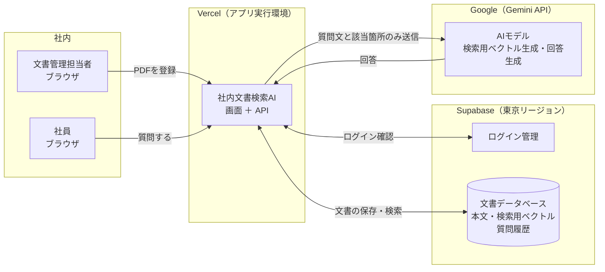
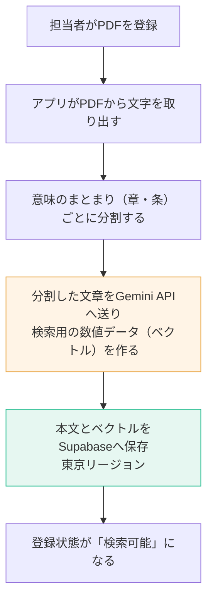
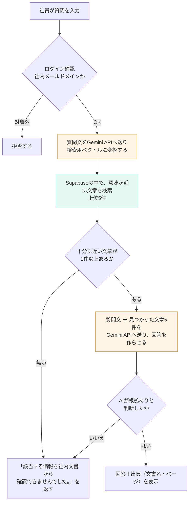
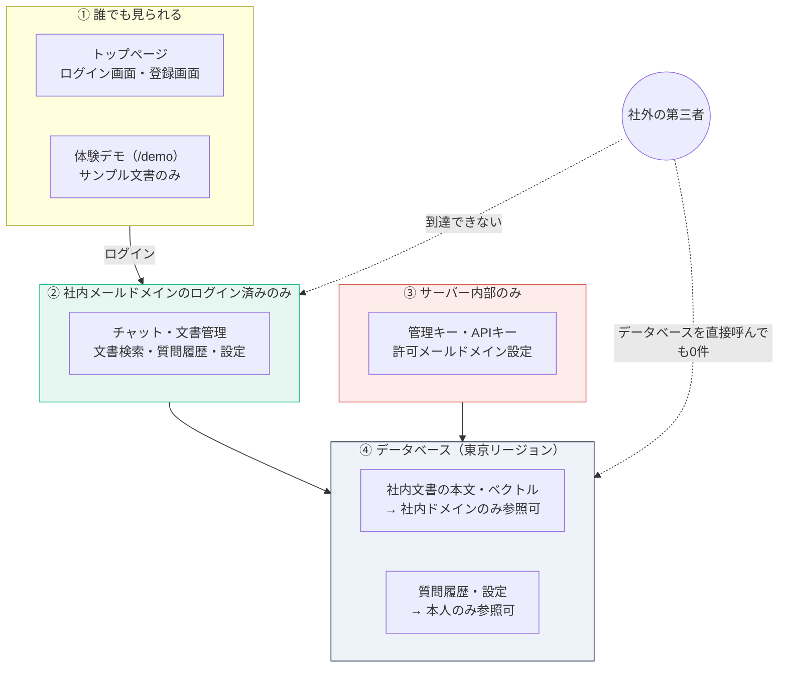
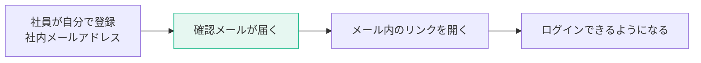

# システム構成の説明資料（情報システム部門向け）

社内文書検索AI（RAG）MVP

このドキュメントは、**情報システム部門のご担当者が社内へ説明する際に使う資料**です。
開発者向けの詳細は [architecture.md](architecture.md)、操作手順は [operations.md](operations.md) を参照してください。

---

## 1. 一言でいうと

**社内のPDFを取り込んでおき、社員がチャットで質問すると、その文書を根拠にAIが回答するシステムです。**

| 特徴 | 内容 |
|---|---|
| 根拠が必ず示される | 回答には文書名・ページ番号・該当箇所が付く |
| 書いていないことは答えない | 根拠が無い場合は「該当する情報を社内文書から確認できませんでした。」と返す |
| 社内の人しか使えない | 社内メールドメイン以外はログインも閲覧もできない |
| 対象はPDFのみ（MVP） | Word・Confluenceは次フェーズ |

---

## 2. 全体構成

### 使っている外部サービス

| サービス | 役割 | 保存されるもの | リージョン |
|---|---|---|---|
| **Vercel** | アプリの実行環境 | 文書データは保存しない（処理のみ） | 設定による |
| **Supabase** | ログイン管理・データベース | **社内文書の本文・検索用ベクトル・質問履歴** | **東京（ap-northeast-1）** |
| **Gemini API（Google）** | 検索用ベクトル生成・回答生成 | 送信データの保持条件は要確認（下記7章） | **未確定（要確認）** |

> **Gemini APIの採用は確定ではありません。**
> 今回はMVPのコスト都合による選定です。本番導入前の再評価事項は7章に記載しています。

---

## 3. データの流れ

### 3-1. 文書を取り込むとき

**Gemini APIへ送るのは、分割した文章のテキストだけです。** PDFファイルそのものは送りません。

### 3-2. 社員が質問するとき

### 社外へ出ていく情報（重要）

**オレンジ色の箇所だけが、社外（Google）へ通信します。**

| 送るもの | 送らないもの |
|---|---|
| 社員が入力した質問文 | PDFファイルそのもの |
| 検索でヒットした文章の本文（最大5件分） | ヒットしなかった文書の内容 |
| — | 社員の氏名・メールアドレス |
| — | 質問履歴（Supabaseにのみ保存） |

「社内文書の一部は外部のAIサービスへ送信される」という点は、
社内説明で**必ず明示してください**。ここを曖昧にすると後で問題になります。

---

## 4. セキュリティ境界

### 社内の人だけが使えることを、4か所で確認しています

| # | どこで | 何を確認するか |
|---|---|---|
| 1 | **アカウント作成時（Auth Hook）** | 社内メールアドレス以外は、そもそも登録できない |
| 2 | ログイン画面・登録API | 社内メールアドレスかどうか |
| 3 | すべての画面・APIアクセス | ログイン済みか、社内メールドメインか（毎回） |
| 4 | **データベース（RLS）** | 社内メールドメインのアカウントか |

**1と4が重要です。** 2と3はアプリの中の確認であり、アプリを経由しない経路には効きません。
データベースへ接続するための公開キーはブラウザに配布される仕組みのため、
第三者がアプリを通さずデータベースを直接呼ぶことが技術的には可能です。
そのため、**データベース側でも社内ドメインを確認**しています。

社内説明では「ログイン画面で弾いています」ではなく、
**「データベース自体が社外アカウントには何も返さない設定になっています」**と説明できます。

### 認証の仕組み

**社内メールを受信できることが、本人確認の唯一の手段です。**
確認メールの設定（Supabaseの「Confirm email」）を無効化すると、
社内アドレスを騙って登録した相手がそのまま利用できてしまいます。**絶対に無効化しないでください。**

### リージョンの整理

| 項目 | 現状 |
|---|---|
| データベース（文書本文・ベクトル・質問履歴） | **東京（ap-northeast-1）** |
| ログイン情報 | **東京（同上）** |
| Gemini APIの処理・保存 | **未確定**（現在の契約形態では国内保証なし） |

**「すべて国内で処理しています」とは説明できません。**
質問文と検索でヒットした文章はGoogleのAPIへ送信されます。
国内リージョンが必須要件であれば、7章の再評価が必要です。

---

## 5. 社内説明で使えるQ&A

社内から出やすい質問と、そのまま使える回答です。

| 社内からの質問 | 回答（説明できる言葉で） |
|---|---|
| 社内文書が外部に漏れないか | データベースは東京のサーバーに保存しています。社内メールアドレス以外はアクセスできません。システムを経由せずデータベースを直接呼ばれても、社外のアカウントには何も返しません |
| AIが間違ったことを言わないか | 文書に書いていないことは「確認できませんでした」と答える設計です。12問の検証で、根拠なしの回答は**0件**でした |
| 誰でも全ての文書を見られるか | **現在はログインした社員全員が全文書を検索できます。**部署別の制限は次フェーズで対応可能です。**限定公開すべき文書は登録しないでください** |
| AIが社内情報を学習に使うか | 現在使用中のAIサービスの契約条件を**確認中**です。本番導入前に必ず確認します |
| どこまで正確なのか | 5文書・12問の検証で、記載のある質問への正答率は100%でした。ただし**全社内文書・全質問への精度を保証するものではありません** |
| PDFファイルそのものが外部へ送られるのか | 送られません。外部へ出るのは「社員の質問文」と「検索で見つかった文章の一部」だけです |
| ログインできるのは誰か | 社内メールアドレスを持ち、確認メールのリンクを開いた人だけです |
| 退職者はどうなるか | アカウントを無効にすれば利用できなくなります。**無効化の運用ルールは社内で定めてください** |
| 文書の更新は誰がやるのか | 管理画面から担当者が実施できます。開発者への依頼は不要です |
| 費用はどれくらいか | 現在は無料の範囲で動作しています。**本格運用には有料プランが必要**で、金額は構成の決定後に試算します |
| 使えなくなったらどうするか | [operations.md](operations.md) の13章に症状別の対処をまとめています |

**【注意】** 上の表で**太字**にした箇所は、曖昧に説明すると後で問題になる部分です。
「まだ確認中」「現時点ではできない」ことは、そのまま伝えてください。

---

## 6. 絶対に確認してから進めること

本番導入を判断する前に、以下を必ず確認してください。
**1つでも未確認の項目があれば、機密文書の登録は行わないでください。**

- [ ] **社内文書をAIサービスへ送信してよいか**（社内規程・取引先との秘密保持契約の確認）
- [ ] **国内リージョンが必須かどうか**（現在AIの処理場所は未確定）
- [ ] **想定利用人数と月額費用の確認**（現在は無料の範囲で動作しており本格運用には耐えない）
- [ ] **部署別アクセス制御が必要かどうか**（機密文書を登録する場合は必須）
- [ ] 送信データがAIの学習に使われないことの契約上の保証
- [ ] 送信データの保存期間
- [ ] 退職・異動時のアカウント運用ルールを社内で定めたか
- [ ] 文書の更新担当者を決めたか

**【最優先】1つ目の確認から着手してください。**
「送信不可」という結論の場合、構成を根本から見直す必要があり、
他の検討がすべてやり直しになります。

---

## 7. 本番導入前に確認が必要なこと

情報システム部門として判断が必要な項目です。

| # | 確認事項 | なぜ必要か |
|---|---|---|
| 1 | 社内文書の本文を外部AIサービスへ送信してよいか | 社内規程・取引先との秘密保持契約に抵触しないか |
| 2 | 処理・保存のリージョン | 国内限定が要件なら現構成では満たせない |
| 3 | 送信データがAIの学習に使われないことの契約上の保証 | 保証が無ければ機密文書は載せられない |
| 4 | 送信データの保持期間 | インシデント時の影響範囲の把握に必要 |
| 5 | 想定利用量での月額 | 現在は無料枠（1日20回）で動作しており本格運用には耐えない |
| 6 | SOC2等への対応要否 | 取引先からの要求内容の確認が起点になる |

**1の答えが「送信不可」の場合、構成を根本から見直す必要があります。**
この確認を最優先で行ってください。

---

## 8. 運用体制の想定

| 役割 | 担当 | 作業内容 |
|---|---|---|
| 文書の登録・更新・削除 | 各部門または情報システム部 | 管理画面から操作（専門知識は不要） |
| 環境変数・APIキーの管理 | 情報システム部 | Vercelの管理画面で設定 |
| 利用者アカウント | 社員本人が自己登録 | 社内メールアドレスで登録・確認メールで有効化 |
| 障害・不具合の一次対応 | 情報システム部 | [operations.md](operations.md) の切り分け手順に沿って確認 |
| 開発・改修 | 開発ベンダー | Phase 2の機能追加など |

**日常の文書更新に開発者は不要です。** 管理画面から担当者が実施できます。

---

## 9. 現時点での制約（社内説明時に伝えるべきこと）

| 制約 | 内容 |
|---|---|
| 対象はPDFのみ | Word・Confluenceは未対応（Phase 2） |
| 部署別の出し分けなし | **ログインした社員は全文書を検索できる**。人事・給与など限定文書は載せないこと |
| 自動更新なし | 文書を改訂したら担当者が登録し直す必要がある |
| スキャンPDF非対応 | 紙をスキャンした画像のみのPDFは取り込めない |
| 利用回数の制限 | 無料枠のため1日20回・毎分5回。本格運用には有料プランが必要 |
| 精度の保証範囲 | 5文書・12問での検証結果（回答精度100%・ハルシネーション0件）。全質問への精度保証ではない |

**「部署別の出し分けが無い」ことは必ず周知してください。**
限定公開すべき文書を登録すると、全社員が閲覧できる状態になります。

---

## 関連ドキュメント

| ファイル | 対象読者 | 内容 |
|---|---|---|
| [operations.md](operations.md) | 運用担当者 | 日常の操作手順・トラブルシューティング |
| [architecture.md](architecture.md) | 開発者 | 技術詳細・DB構造・API仕様 |
| [phase2-proposal.md](phase2-proposal.md) | 意思決定者 | 次フェーズの機能・費用・工数 |
| [validation/rag-accuracy-report.md](validation/rag-accuracy-report.md) | 全員 | 精度検証の詳細 |
