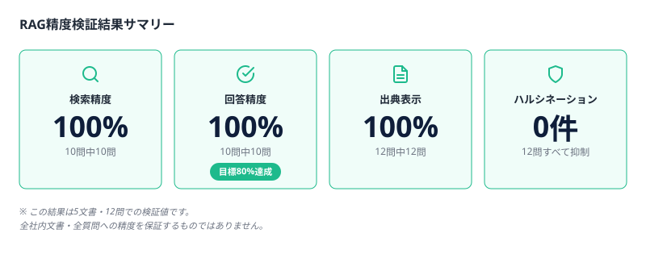
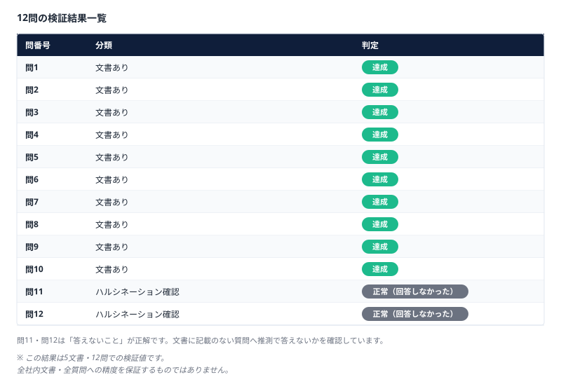
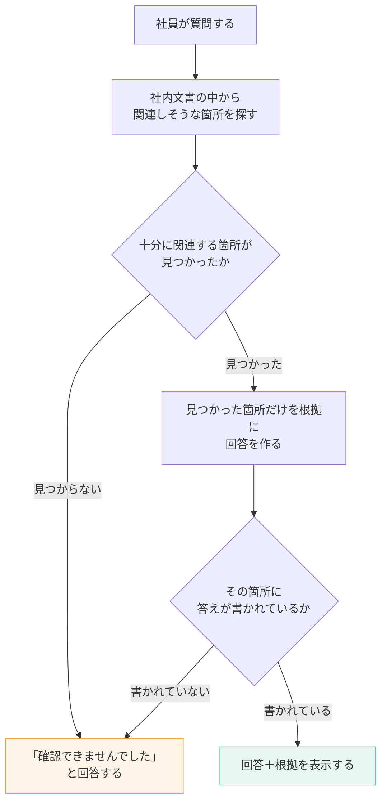

# AI回答精度の検証レポート

社内文書検索AI　検証結果のご報告

最終検証日：2026年8月20日

---

## 検証結果サマリー（1分で読めます）



| 確認したこと | 結果 | 判定 |
|---|---|---|
| 正しい文書を見つけられるか | 10問中10問（100%） | **達成** |
| 正しく回答できるか | 10問中10問（100%） | **達成**（目標80%以上） |
| 回答の根拠を示せるか | 12問中12問（100%） | **達成** |
| でたらめな回答をしないか | 0件 | **達成** |

> **【注意】この結果は5文書・12問での検証値です。**
> **全社内文書・全質問への精度を保証するものではありません。**
> 文書量が増えた段階で、改めて検証することを推奨します。

---

## この検証で分かったこと（3点）

**1. 社内文書に書かれている内容には、正確に答えられます**

金額・日数・期限といった数値を、文書の記載どおりに回答できました。
言い回しではなく**事実（数値・固有名詞）が合っているか**で判定しています。

**2. 書かれていないことは、推測せずに「確認できませんでした」と答えます**

文書に記載のない2問では、いずれも推測で答えることはありませんでした。
**社員が誤った情報で判断してしまうリスクを避けられます。**

**3. 回答には必ず根拠が付きます**

12問すべてで、根拠となった文書名・ページ番号・該当箇所を表示できました。
利用者は原文を開いて内容を確認できます。

---

## 検証の条件

| 項目 | 内容 |
|---|---|
| 質問データ | 評価データ12問 |
| 対象文書 | 5文書（就業規則・経費精算マニュアル・情報セキュリティ規程・リモートワーク規程・ITツール申請ガイド） |
| 検証方法 | 実際の運用と同じ操作（ログインした状態でチャット画面から質問） |
| 質問の内訳 | 文書に記載あり 10問／文書に記載なし 2問 |

**「記載なし」の2問は、でたらめな回答をしないかを確かめるための質問です。**
正解は「答えられない」ことであり、答えてしまったら不合格になります。

---

## 12問の結果一覧



質問文と根拠として使った文書は、次の表で確認できます。

| 問 | 質問 | 判定 | 使った文書 | 備考 |
|---|---|---|---|---|
| 1 | 有給休暇は入社何ヶ月後に何日付与されますか？ | **正解** | 就業規則（第2章 休日・休暇 / p.1） | 入社6ヶ月後に10日 |
| 2 | 経費精算の締め日と振込日はいつですか？ | **正解** | 経費精算マニュアル（1. 精算の基本フロー / p.1） | 月末締め・翌月10日申請・翌月25日振込 |
| 3 | リモートワークは週何日まで可能ですか？ | **正解** | リモートワーク規程（2. 実施頻度・時間 / p.1） | 週3日まで |
| 4 | パスワードの最低文字数と変更頻度を教えてください。 | **正解** | 情報セキュリティ規程（1. パスワード管理 / p.1） | 12文字以上・90日ごと。質問されていない「過去3回分と同一は不可」は回答に含まれず（合否には影響なし） |
| 5 | 在宅勤務手当はいくら支給されますか？ | **正解** | 経費精算マニュアル（5. 在宅勤務手当 / p.1・p.2）<br>リモートワーク規程（4. 手当 / p.1） | 月額3,000円。**2つの文書にまたがる質問にも正しく回答** |
| 6 | 接待交際費の1人あたりの上限はいくらですか？ | **正解** | 経費精算マニュアル（3. 接待交際費 / p.1） | 5,000円。超える場合は部門長の事前承認も併記 |
| 7 | PCを紛失した場合、どこに何分以内に報告しますか？ | **正解** | 情報セキュリティ規程（4. インシデント対応 / p.1） | 情報システム部へ30分以内 |
| 8 | リモートワークのコアタイムは何時から何時ですか？ | **正解** | リモートワーク規程（2. 実施頻度・時間 / p.1） | 11:00〜15:00 |
| 9 | 新しいツールのアカウントは申請からどのくらいで発行されますか？ | **正解** | ITツール申請ガイド（4. アカウント申請の流れ / p.2） | 2営業日以内。**前回の検証で唯一答えられなかった問題（下記参照）** |
| 10 | 時間外労働の上限は月何時間・年何時間ですか？ | **正解** | 就業規則（第3章 時間外労働 / p.1） | 月45時間・年360時間 |
| 11 | 育児休業の取得条件を教えてください。 | **正解**（答えないのが正解） | なし | 「該当する情報を社内文書から確認できませんでした。」と回答 |
| 12 | 退職金はいくらもらえますか？ | **正解**（答えないのが正解） | なし | 同上 |

**問11・12は「答えられない」ことが正解です。**
この2問については、文書を見つけられないことが正しい動作のため、
「正しい文書を見つけられるか」の集計（10問）には含めていません。

全12問の質問文・AIの回答全文・使用した文書は
[記録シート](rag-evaluation-sheet.md) に自動出力されています。

---

## 文書にない質問への対応（最も重要な確認項目）

### なぜこれが重要か

社内文書検索AIで**いちばん危険なのは、書かれていないことをそれらしく答えてしまうこと**です。

| 起きること | 影響 |
|---|---|
| AIが一般論で「育児休業は1年です」と答える | 社員が自社の規程だと信じて行動する |
| 実際の社内規程と違っていた | 手続きの誤り・トラブル・信用の低下 |
| 「AIが言っていた」で判断される | 誰の責任か分からなくなる |

**回答が速くても、この1点が守られていなければ業務では使えません。**

### 検証結果

**12問すべてで、文書にない情報を推測して答えることはありませんでした。**

| 確認内容 | 結果 |
|---|---|
| 文書に記載のない質問（2問）への回答 | 2問とも「該当する情報を社内文書から確認できませんでした。」 |
| 根拠を示さずに断定した回答 | **0件** |
| 実在しない文書を根拠として示した回答 | **0件** |

### どうやって防いでいるか



**2段階で確認しています。**

1. 文書を探す段階で、関連する箇所が見つからなければ、その時点で「確認できませんでした」と返します
2. 見つかった場合でも、そこに答えが書かれていなければ「確認できませんでした」と返します

一般知識で補うことはしません。**社内文書に書かれていることだけが回答の材料です。**

---

## 前回の検証からの改善

2026年8月17日の検証では、10問中1問（問9）に答えられませんでした。

| 項目 | 8月17日 | 8月20日 |
|---|---|---|
| 正しい文書を見つけられるか | 10/10（100%） | 10/10（100%） |
| 正しく回答できるか | 9/10（90%） | **10/10（100%）** |
| 回答の根拠を示せるか | 11/12（91.7%） | **12/12（100%）** |
| でたらめな回答をしないか | 0件 | 0件 |

### 何が原因だったか

問9「新しいツールのアカウントは申請からどのくらいで発行されますか？」の正解は
「情報システム部が2営業日以内に発行」です。

この一文は探し出せていましたが、**文書を区切る位置が申請手順の途中に入っていた**ため、
AIから見ると「この一文が何の手順の3番目なのか」が判断できませんでした。
結果として、根拠として採用せず「確認できませんでした」と回答していました。

**推測で答えなかったという意味では、正しい動作です。**

### どう直したか

文書を区切る位置を、**文字数ではなく見出し（第○章・第○条・1.2.3 など）で決める**方式に変更しました。

| 変更前 | 変更後 |
|---|---|
| 決まった文字数で機械的に区切る | 見出しごとに区切る |
| 1つの区切りに複数の章が混ざることがある | 1つの区切り＝1つの見出し |
| 手順の途中で切れることがある | 手順がひとまとまりで残る |

この変更により、問9に正しく答えられるようになりました。
あわせて、根拠として表示される「該当箇所」が実際の記載位置と一致するようになり、
**根拠の表示も12問すべてで正しくなりました。**

---

## 今後の精度改善の余地

現時点で目標を達成しているため、追加の調整は行っていません。
今後、文書量を増やす際に検討できる項目を挙げます。

| # | 検討項目 | 内容 | 判断が必要な理由 |
|---|---|---|---|
| 1 | 文書を探すときの合格ラインの調整 | 「どの程度関連していれば回答の材料にするか」の基準値 | 上げると無関係な文書が混ざりにくくなるが、**補助的な情報も材料から外れる**。現在の12問では判断材料が少ないため、質問を追加して再測定してから判断すべき |
| 2 | 材料にする文書の件数 | 現在は上位5件（設定画面で3・5・10から変更可） | 多いほど材料は増えるが、無関係な内容が混ざり回答がぼやける |
| 3 | 文書側の見出しの整備 | 規程・マニュアルの見出しを揃える | **AIの設定ではなく文書側の改善**。見出しが明確なほど、区切りの精度と根拠の表示精度が上がる |

**最も効果が大きいのは3です。**
今回の唯一の不正解も、AIの性能ではなく文書の作りが原因でした。
文書量を増やす際は、見出し構造を意識して作成いただくと精度が安定します。

### 文書量が増えたときの注意

| 懸念 | 内容 |
|---|---|
| 無関係な文書が候補に入りやすくなる | 文書が増えるほど、似た表現の文書がヒットする確率が上がります |
| 再検証が必要 | 現在の数値は5文書での実測値です。**文書を大幅に増やしたら、改めて検証することを推奨します** |

---

## 運用上の注意

### 質問できる回数に上限があります

現在は無料の範囲で動作しており、**1日20回・1分間に5回**の上限があります。

| 症状 | 原因 | 対処 |
|---|---|---|
| 続けて質問すると「利用制限に達しました」と出る | 回数の上限 | 1分ほど待ってから再度お試しください |

**これはAIの精度が落ちたのではなく、回数の上限です。**
この制約を知らずに連続で試すと、精度が低いと誤解されることがあります。

本格運用の際は、有料プランへの切り替えが必要です。

### 検証をやり直す方法

```bash
# 1. 開発サーバーを起動（別のターミナルで実行）
npm run dev

# 2. 12問の検証を実行（約3分・記録シートを自動生成）
npm run validate:rag
```

結果は [記録シート](rag-evaluation-sheet.md) に自動で書き出されます。
上限に達しないよう、質問は15秒間隔で投入されます。

---

## クライアント報告用サマリー

- 社内文書に記載された内容への**正答率は100%**（目標80%・12問中の記載あり10問）
- 文書に記載のない質問には**推測せず「確認できませんでした」と回答**（2問中2問）
- 回答には**根拠となる文書名・ページ番号を必ず表示**（12問すべて）
- **でたらめな回答は0件**

> **【注意】** 上記は5文書・12問での検証結果です。
> 全社内文書・全質問への精度を保証するものではありません。

---

## 関連ドキュメント

| ファイル | 内容 |
|---|---|
| [rag-evaluation-sheet.md](rag-evaluation-sheet.md) | 全12問の質問文・AIの回答全文・使用文書の記録（自動生成） |
| [images/](images/) | 本レポートの図版（`npm run generate:report-images` で生成） |
| [../system-overview.md](../system-overview.md) | 情報システム部門向けのシステム構成資料 |
| [../operations.md](../operations.md) | 運用担当者向けの操作手順 |
| [../phase2-proposal.md](../phase2-proposal.md) | 次のステップのご提案 |
